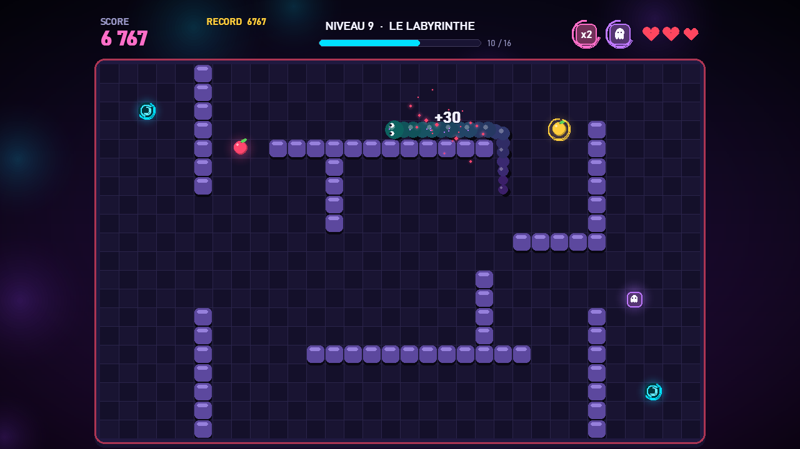
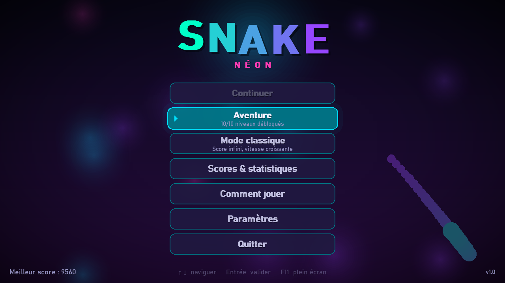
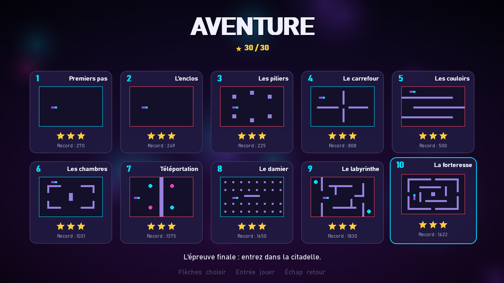
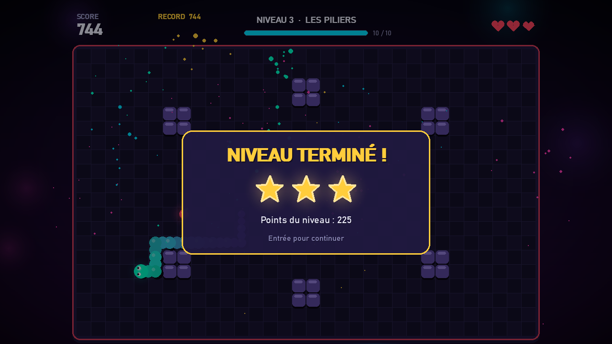
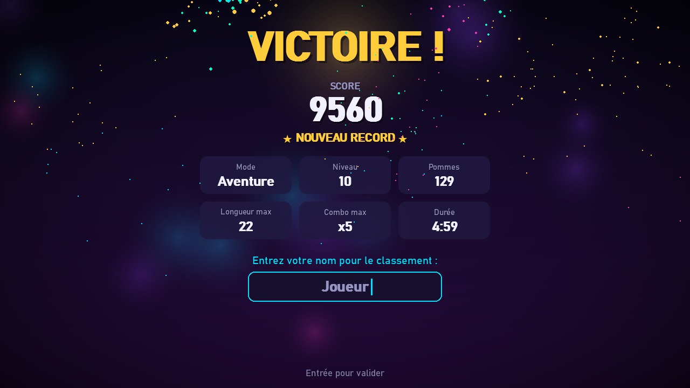
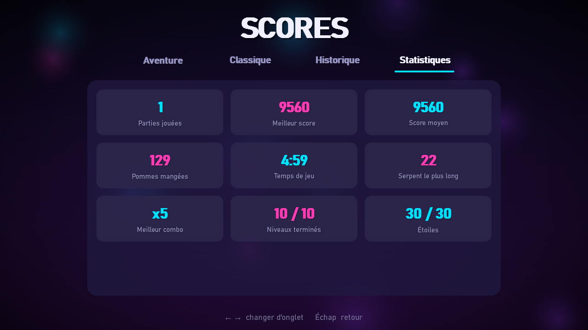
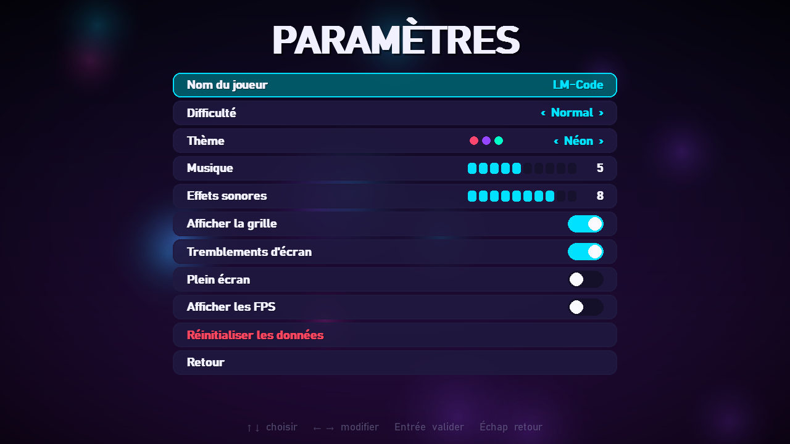

# 🐍 Snake Néon

Un jeu de **Snake** complet en Python avec **Pygame** : graphismes néon, animations fluides,
10 niveaux, bonus, scores et sauvegarde dans une base **SQLite** locale.



## ✨ Fonctionnalités

- **Mode Aventure** : 10 niveaux (obstacles, murs, portails), 3 vies, jusqu'à 3 étoiles par niveau
- **Mode Classique** : partie infinie, la vitesse augmente au fil des pommes
- **Bonus** : pomme dorée, Ralenti, Fantôme, Score x2, Rétrécir, et combos jusqu'à x5
- **Animations** : mouvement fluide, particules, halos néon, transitions entre les écrans
- **Responsive** : s'adapte à toutes les tailles de fenêtre, plein écran avec `F11`
- **4 thèmes de couleurs**, musique et sons générés par le code
- **Sauvegarde SQLite** : scores, historique, statistiques, progression et bouton « Continuer »

## 🖼️ Captures d'écran

| Menu principal | Choix du niveau |
|---|---|
|  |  |
| **Niveau terminé** | **Victoire** |
|  |  |
| **Statistiques** | **Paramètres** |
|  |  |

## 🚀 Installer et jouer

### 1. Prérequis

- [Python 3.10 ou plus récent](https://www.python.org/downloads/) (sous Windows, cochez **« Add Python to PATH »** pendant l'installation)
- [Git](https://git-scm.com/downloads) (facultatif)

### 2. Télécharger le projet

**Avec Git :**

```bash
git clone https://github.com/LM-Code-Be/snake-game.git
cd snake-game
```

**Sans Git :** sur la [page du dépôt](https://github.com/LM-Code-Be/snake-game), cliquez sur
**Code ▸ Download ZIP**, décompressez l'archive, puis ouvrez un terminal dans le dossier obtenu.

### 3. Installer et lancer

**Windows**

```bash
python -m venv .venv
.venv\Scripts\activate
pip install -r requirements.txt
python main.py
```

**macOS / Linux**

```bash
python3 -m venv .venv
source .venv/bin/activate
pip install -r requirements.txt
python main.py
```

Au premier lancement, un dossier `data/` est créé : il contient la base `snake.db` (scores, sauvegarde,
paramètres) et la musique générée.

### Un souci ?

| Problème | Solution |
|---|---|
| `python` n'est pas reconnu | Réinstallez Python en cochant « Add Python to PATH », ou utilisez `py` (Windows) / `python3` (macOS, Linux). |
| `No module named 'pygame'` | Activez l'environnement virtuel, puis relancez `pip install -r requirements.txt`. |
| Repartir de zéro (scores, progression) | Supprimez le dossier `data/` ; il sera recréé au prochain lancement. |

## 🎮 Commandes

| Touche | Action |
|---|---|
| Flèches / ZQSD / WASD | Diriger le serpent |
| Échap ou P | Pause |
| Entrée | Valider / passer l'introduction |
| F11 ou Alt + Entrée | Plein écran |

## 📁 Structure du projet

```
snake-game/
├── main.py              # Point d'entrée
├── requirements.txt     # Dépendances (pygame)
├── TUTORIEL.md          # Tutoriel complet pour recréer le jeu pas à pas
├── LICENSE              # Licence MIT
├── docs/screenshots/    # Captures d'écran
└── snake_game/
    ├── app.py           # Fenêtre, boucle principale, transitions
    ├── config.py        # Réglages, couleurs, thèmes
    ├── database.py      # Base SQLite
    ├── audio.py         # Sons et musique synthétisés
    ├── ui.py            # Outils d'interface (texte, boutons, menus)
    ├── effects.py       # Particules, fond animé, transitions
    ├── entities.py      # Serpent et objets
    ├── levels.py        # Les 10 niveaux
    ├── renderer.py      # Dessin du plateau et du serpent
    └── scenes/          # Les écrans : menu, jeu, scores, paramètres...
```

## 📚 Apprendre à le créer

Le fichier [TUTORIEL.md](TUTORIEL.md) explique **pas à pas** comment écrire ce jeu de zéro,
fichier par fichier, avec tout le code commenté.

📖 Retrouvez aussi l'article complet sur le blog : **[Créer un jeu Snake en Python avec Pygame](https://lm-code.be/jeu-snake-en-python-pygame/)**

## 👤 Crédits

Développé par **LM-Code** : [github.com/LM-Code-Be](https://github.com/LM-Code-Be)

## 📄 Licence

Ce projet est distribué sous licence **MIT** : voir le fichier [LICENSE](LICENSE).
