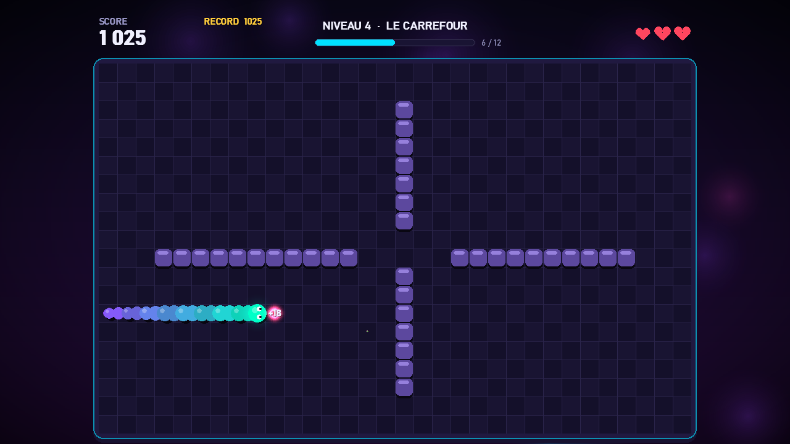
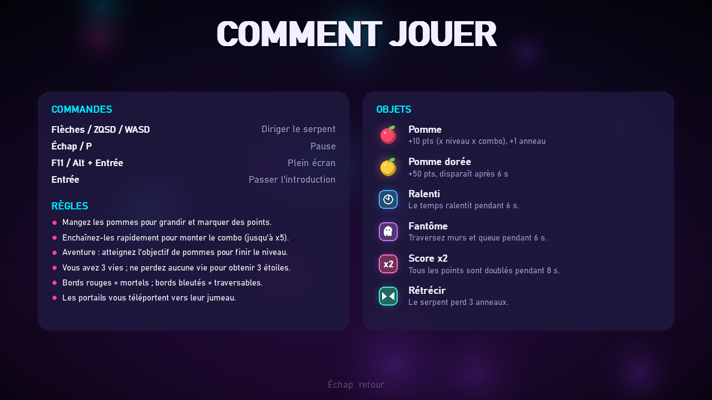

# Tutoriel : créer un jeu de Snake complet en Python avec Pygame

Bienvenue ! Dans ce tutoriel, nous allons construire **pas à pas** le jeu *Snake Néon* :
un Snake moderne avec des animations, des niveaux, des bonus, des scores sauvegardés dans une
base SQLite, de la musique… et tout cela **sans aucun fichier image ni son** : tout est dessiné
et synthétisé par le code.


À la fin, vous aurez exactement le même jeu que celui du dépôt
[github.com/LM-Code-Be/snake-game](https://github.com/LM-Code-Be/snake-game).

---

## Sommaire

0. [Ce qu'il faut savoir avant de commencer](#étape-0--ce-quil-faut-savoir-avant-de-commencer)
1. [Préparer le projet](#étape-1--préparer-le-projet)
2. [La configuration (`config.py`)](#étape-2--la-configuration-configpy)
3. [La boîte à outils graphique (`ui.py`)](#étape-3--la-boîte-à-outils-graphique-uipy)
4. [La base de données SQLite (`database.py`)](#étape-4--la-base-de-données-sqlite-databasepy)
5. [Les sons et la musique (`audio.py`)](#étape-5--les-sons-et-la-musique-audiopy)
6. [Les effets visuels (`effects.py`)](#étape-6--les-effets-visuels-effectspy)
7. [Le serpent et les objets (`entities.py`)](#étape-7--le-serpent-et-les-objets-entitiespy)
8. [Les niveaux (`levels.py`)](#étape-8--les-niveaux-levelspy)
9. [Le rendu du plateau (`renderer.py`)](#étape-9--le-rendu-du-plateau-rendererpy)
10. [Le système de scènes (`scenes/base.py`)](#étape-10--le-système-de-scènes-scenesbasepy)
11. [L'application et la boucle principale (`app.py`, `main.py`)](#étape-11--lapplication-et-la-boucle-principale-apppy-mainpy)
12. [Le menu principal (`scenes/menu.py`)](#étape-12--le-menu-principal-scenesmenupy) : premier lancement !
13. [Le cœur du jeu (`scenes/game.py`)](#étape-13--le-cœur-du-jeu-scenesgamepy)
14. [L'écran de fin de partie (`scenes/gameover.py`)](#étape-14--lécran-de-fin-de-partie-scenesgameoverpy)
15. [Le choix du niveau (`scenes/level_select.py`)](#étape-15--le-choix-du-niveau-sceneslevel_selectpy)
16. [Scores et statistiques (`scenes/scores.py`)](#étape-16--scores-et-statistiques-scenesscorespy)
17. [Les paramètres (`scenes/settings.py`)](#étape-17--les-paramètres-scenessettingspy)
18. [L'aide (`scenes/help.py`)](#étape-18--laide-sceneshelppy)
19. [Tester, et aller plus loin](#étape-19--tester-et-aller-plus-loin)

---

## Étape 0 : ce qu'il faut savoir avant de commencer

### Niveau requis

Vous devez connaître les bases de Python : variables, fonctions, listes, dictionnaires, boucles
et classes (`class`, `self`, `__init__`). Aucune connaissance préalable de Pygame n'est nécessaire :
nous expliquerons chaque fonction utilisée.

### Comment fonctionne un jeu vidéo ?

Un jeu est un programme qui tourne en **boucle**, des dizaines de fois par seconde. À chaque tour
(on parle d'**image** ou de *frame*), il fait toujours trois choses :

```
tant que le jeu tourne :
    1. lire les événements   (touches pressées, souris, fermeture de la fenêtre)
    2. mettre à jour         (déplacer le serpent, vérifier les collisions, animer...)
    3. dessiner              (effacer l'écran, tout redessiner, afficher)
```

Avec Pygame, ces trois étapes s'écrivent ainsi (exemple minimal, à ne pas garder) :

```python
import pygame

pygame.init()
ecran = pygame.display.set_mode((640, 480))   # crée la fenêtre
horloge = pygame.time.Clock()

en_cours = True
while en_cours:
    for event in pygame.event.get():            # 1. événements
        if event.type == pygame.QUIT:
            en_cours = False
    # 2. mise à jour : rien ici
    ecran.fill((20, 20, 40))                    # 3. dessin : on remplit l'écran
    pygame.draw.circle(ecran, (0, 255, 200), (320, 240), 40)
    pygame.display.flip()                       # on affiche l'image dessinée
    horloge.tick(60)                            # on limite à 60 images par seconde

pygame.quit()
```

Tout notre jeu n'est qu'une version très organisée de cette boucle.

### Quelques notions Pygame que nous utiliserons partout

| Notion | Explication |
|---|---|
| `Surface` | Une « feuille » de pixels sur laquelle on dessine. L'écran est une surface. |
| `blit` | Coller une surface sur une autre : `ecran.blit(image, (x, y))`. |
| `Rect` | Un rectangle (x, y, largeur, hauteur) avec des attributs pratiques : `center`, `midtop`, `right`... |
| Couleur | Un tuple `(rouge, vert, bleu)` de 0 à 255, ou `(r, g, b, alpha)` avec transparence. |
| Coordonnées | L'origine `(0, 0)` est en **haut à gauche** ; `y` augmente vers le bas. |
| `dt` | Le temps écoulé depuis l'image précédente, en secondes. On s'en sert pour animer à vitesse constante. |

### L'architecture du jeu

Plutôt qu'un seul gros fichier, nous découpons le jeu en **modules** qui ont chacun un rôle précis :

```
snake-game/
├── main.py                  Lance le jeu
├── requirements.txt         Dépendances (pygame)
└── snake_game/              Le package du jeu
    ├── config.py            Constantes et réglages
    ├── ui.py                Outils de dessin et d'interface
    ├── database.py          Sauvegarde SQLite
    ├── audio.py             Synthèse sonore
    ├── effects.py           Particules, fond animé, transitions
    ├── entities.py          Le serpent et les objets
    ├── levels.py            Les niveaux
    ├── renderer.py          Dessin du plateau et du serpent
    ├── app.py               La boucle principale
    └── scenes/              Les « écrans » du jeu
        ├── base.py          Classe commune à tous les écrans
        ├── menu.py          Menu principal
        ├── game.py          La partie elle-même
        ├── gameover.py      Fin de partie
        ├── level_select.py  Choix du niveau
        ├── scores.py        Classements et statistiques
        ├── settings.py      Paramètres
        └── help.py          Aide
```

Nous écrirons les fichiers **dans l'ordre**, des briques les plus simples (qui ne dépendent de rien)
jusqu'aux écrans qui utilisent tout le reste.

> 💡 **Conseil** : recopiez le code vous-même plutôt que de le coller. C'est en tapant qu'on comprend.
> Les commentaires du code sont en français et complètent les explications du tutoriel.

---

## Étape 1 : préparer le projet

### 1.1 Installer Python

Téléchargez Python 3.10 ou plus récent sur [python.org](https://www.python.org/downloads/).
Sous Windows, cochez **« Add Python to PATH »** pendant l'installation. Vérifiez dans un terminal :

```bash
python --version
```

### 1.2 Créer le dossier et l'environnement virtuel

Un **environnement virtuel** est un dossier qui contient une copie isolée de Python et des
bibliothèques du projet. Ainsi, les bibliothèques installées pour ce jeu ne se mélangent pas
avec celles de vos autres projets.

```bash
mkdir snake-game
cd snake-game
python -m venv .venv
```

Activez-le (à refaire à chaque nouveau terminal) :

```bash
# Windows
.venv\Scripts\activate
# macOS / Linux
source .venv/bin/activate
```

Le nom `(.venv)` apparaît alors au début de la ligne de commande.

### 1.3 Installer Pygame

Créez le fichier `requirements.txt`, qui liste les dépendances du projet :

```text
pygame>=2.5
```

Puis installez-les :

```bash
pip install -r requirements.txt
```

### 1.4 Créer l'arborescence

Créez les dossiers `snake_game` et `snake_game/scenes`. Pour que Python les considère comme des
**packages** (des dossiers dont on peut importer les fichiers), chacun doit contenir un fichier
`__init__.py`. Le nôtre contient simplement une ligne de description.

`snake_game/__init__.py` :

```python
"""Snake Néon : un jeu de Snake complet avec Pygame."""
```

`snake_game/scenes/__init__.py` :

```python
"""Scènes du jeu (écrans)."""
```

Ajoutez enfin un `.gitignore`, pour que Git ignore l'environnement virtuel, les fichiers compilés
et les données générées (base de données, musique) :

```text
.venv/
__pycache__/
data/
```

---

## Étape 2 : la configuration (`config.py`)

On commence par regrouper **toutes les valeurs réglables** dans un seul fichier. Si vous voulez plus
tard changer la taille de la grille ou une couleur, vous saurez où chercher.

Points importants :

- **`Path(__file__).resolve().parent.parent`** : `__file__` est le chemin du fichier courant
  (`snake_game/config.py`). On remonte de deux niveaux pour obtenir la racine du projet, où l'on
  placera le dossier `data/`. Ainsi, le jeu trouve ses données quel que soit le dossier depuis lequel
  on le lance.
- **La grille** fait `32 × 20` cases. Les positions sont des tuples `(x, y)` en **cases**, pas en pixels.
- **Les directions** sont des vecteurs : `UP = (0, -1)` signifie « x ne change pas, y diminue de 1 »
  (on monte, puisque y augmente vers le bas). `OPPOSITE` associe chaque direction à son contraire :
  il servira à interdire le demi-tour.
- **`DIFFICULTIES`** : chaque difficulté multiplie la vitesse et les points.
- **`THEMES`** : un thème est un dictionnaire de couleurs. Tout le code utilise
  `theme["accent"]`, `theme["board"]`... et jamais une couleur écrite en dur : changer de thème
  recolore donc tout le jeu instantanément. La petite boucle finale ajoute à chaque thème une clé
  `name` (son identifiant), utile pour les caches.
- **`DEFAULT_SETTINGS`** : les paramètres au premier lancement, ensuite sauvegardés en base.

`snake_game/config.py` :

```python
"""Configuration globale : fenêtre, grille, vitesses, difficultés, thèmes et bonus."""
from pathlib import Path

# --- Chemins -----------------------------------------------------------------
BASE_DIR = Path(__file__).resolve().parent.parent
DATA_DIR = BASE_DIR / "data"
DB_PATH = DATA_DIR / "snake.db"

# --- Fenêtre -----------------------------------------------------------------
TITLE = "Snake Néon"
VERSION = "1.0"
DEFAULT_WINDOW = (1280, 760)
REFERENCE_SIZE = (1280, 720)   # taille de référence pour l'échelle de l'interface
FPS = 120

# --- Grille de jeu -------------------------------------------------------------
COLS, ROWS = 32, 20

UP, DOWN, LEFT, RIGHT = (0, -1), (0, 1), (-1, 0), (1, 0)
OPPOSITE = {UP: DOWN, DOWN: UP, LEFT: RIGHT, RIGHT: LEFT}

# --- Règles --------------------------------------------------------------------
ADVENTURE_LIVES = 3
CLASSIC_LIVES = 1
COMBO_WINDOW = 2.5          # secondes pour enchaîner un combo
MAX_COMBO = 5
GOLDEN_CHANCE = 0.14        # probabilité d'une pomme dorée après chaque pomme
POWERUP_CHANCE = 0.20       # probabilité d'un bonus après chaque pomme
GOLDEN_TTL = 6.0
POWERUP_TTL = 8.0

DIFFICULTIES = {
    "facile":    {"label": "Facile",    "speed": 0.80, "score": 0.75},
    "normal":    {"label": "Normal",    "speed": 1.00, "score": 1.00},
    "difficile": {"label": "Difficile", "speed": 1.25, "score": 1.50},
}
DIFFICULTY_ORDER = ["facile", "normal", "difficile"]

# --- Bonus ---------------------------------------------------------------------
GOLD = (255, 205, 60)
POWERUPS = {
    "slow":   {"label": "Ralenti",  "color": (80, 170, 255),  "duration": 6.0,
               "desc": "Le temps ralentit pendant 6 s."},
    "ghost":  {"label": "Fantôme",  "color": (190, 120, 255), "duration": 6.0,
               "desc": "Traversez murs et queue pendant 6 s."},
    "double": {"label": "Score x2", "color": (255, 110, 200), "duration": 8.0,
               "desc": "Tous les points sont doublés pendant 8 s."},
    "shrink": {"label": "Rétrécir", "color": (70, 235, 210),  "duration": 0.0,
               "desc": "Le serpent perd 3 anneaux."},
}

# --- Thèmes de couleurs --------------------------------------------------------
THEMES = {
    "neon": {
        "label": "Néon",
        "bg_top": (12, 9, 30), "bg_bottom": (38, 12, 60),
        "board": (20, 16, 42), "board_alt": (25, 20, 50), "grid": (42, 36, 74),
        "panel": (32, 25, 64),
        "snake_head": (0, 255, 200), "snake_tail": (150, 70, 255),
        "accent": (0, 225, 255), "accent2": (255, 60, 180),
        "text": (240, 240, 255), "text_dim": (150, 148, 195),
        "obstacle": (92, 72, 158), "obstacle_light": (150, 128, 220),
        "food": (255, 70, 110), "danger": (255, 70, 95),
    },
    "ocean": {
        "label": "Océan",
        "bg_top": (4, 16, 34), "bg_bottom": (6, 44, 76),
        "board": (8, 28, 52), "board_alt": (10, 34, 60), "grid": (26, 62, 94),
        "panel": (12, 42, 70),
        "snake_head": (100, 245, 255), "snake_tail": (20, 105, 225),
        "accent": (60, 205, 255), "accent2": (255, 200, 80),
        "text": (230, 245, 255), "text_dim": (130, 170, 205),
        "obstacle": (30, 82, 124), "obstacle_light": (64, 136, 186),
        "food": (255, 120, 90), "danger": (255, 95, 95),
    },
    "foret": {
        "label": "Forêt",
        "bg_top": (7, 20, 12), "bg_bottom": (20, 46, 26),
        "board": (14, 32, 20), "board_alt": (17, 38, 24), "grid": (34, 64, 42),
        "panel": (22, 48, 30),
        "snake_head": (195, 255, 90), "snake_tail": (30, 160, 85),
        "accent": (150, 240, 110), "accent2": (255, 210, 90),
        "text": (235, 250, 230), "text_dim": (150, 190, 150),
        "obstacle": (86, 72, 50), "obstacle_light": (138, 118, 82),
        "food": (255, 80, 70), "danger": (255, 95, 70),
    },
    "crepuscule": {
        "label": "Crépuscule",
        "bg_top": (28, 8, 20), "bg_bottom": (74, 24, 42),
        "board": (40, 14, 28), "board_alt": (47, 18, 33), "grid": (76, 36, 56),
        "panel": (58, 20, 38),
        "snake_head": (255, 215, 95), "snake_tail": (255, 70, 125),
        "accent": (255, 150, 80), "accent2": (140, 200, 255),
        "text": (255, 240, 235), "text_dim": (205, 150, 162),
        "obstacle": (104, 42, 72), "obstacle_light": (165, 74, 114),
        "food": (120, 255, 170), "danger": (255, 85, 85),
    },
}
THEME_ORDER = ["neon", "ocean", "foret", "crepuscule"]
for _key, _theme in THEMES.items():
    _theme["name"] = _key

# --- Paramètres par défaut (persistés en base) ---------------------------------
DEFAULT_SETTINGS = {
    "player": "Joueur",
    "difficulty": "normal",
    "theme": "neon",
    "music_volume": 5,
    "sfx_volume": 8,
    "show_grid": True,
    "screen_shake": True,
    "fullscreen": False,
    "show_fps": False,
}
```

---

## Étape 3 : la boîte à outils graphique (`ui.py`)

Ce module contient tous les petits outils de dessin réutilisés partout. Il est long, mais chaque
fonction est simple. Voyons-les par thème.

### 3.1 L'échelle responsive : la fonction `S()`

C'est l'idée centrale qui rend le jeu **responsive**. On conçoit toute l'interface pour une fenêtre
de référence de **1280 × 720**. Puis, quand la fenêtre change de taille, on calcule un facteur :

```python
_scale = min(largeur / 1280, hauteur / 720)
```

Et partout, au lieu d'écrire une taille en pixels, on écrit `S(taille)` :

```python
ui.draw_text(surf, "PAUSE", S(48), ...)   # 48 px en 1280x720, 72 px en 1920x1080
```

On prend le `min` des deux rapports pour que l'interface tienne toujours dans la fenêtre,
même si celle-ci est très large ou très haute.

### 3.2 Maths et couleurs

- `clamp(v)` bloque une valeur entre 0 et 1.
- `lerp(a, b, t)` (*linear interpolation*) renvoie la valeur située à la fraction `t` entre `a` et `b`.
  `lerp(0, 100, 0.25)` vaut `25`. `lerp_color` fait la même chose sur les trois composantes d'une
  couleur : c'est ce qui crée les dégradés du serpent, de la tête vers la queue.
- `lighten` / `darken` éclaircissent ou assombrissent une couleur (mélange avec le blanc ou le noir).
- Les **fonctions d'easing** transforment une progression linéaire `t` (de 0 à 1) en mouvement plus
  naturel :
  - `ease_out_cubic` démarre vite et ralentit à la fin ;
  - `ease_in_out` accélère puis ralentit ;
  - `ease_out_back` dépasse légèrement la cible avant d'y revenir : c'est l'effet « pop » des
    apparitions.

### 3.3 Le texte

Créer une police (`pygame.font.SysFont`) et calculer l'image d'un texte (`font.render`) sont des
opérations coûteuses. On les met donc **en cache** dans des dictionnaires : la première fois qu'on
demande « *SCORE*, taille 15, gris », on calcule l'image ; les fois suivantes, on la récupère
directement.

`SysFont` accepte une liste de polices séparées par des virgules et prend la première disponible :
*Bahnschrift* (moderne, présente sous Windows 10/11), sinon *Segoe UI*, *Verdana*, etc.

Certaines polices n'ont pas de dessin pour les symboles comme `★` ou `↑`. `render_text` découpe donc
le texte en **segments** : les caractères normaux sont rendus avec la police principale, les symboles
(code Unicode ≥ `0x2190`) avec une police de symboles, puis les morceaux sont recollés côte à côte.

`draw_text` dessine un texte avec une petite **ombre** décalée (le même texte en noir, semi-transparent)
pour qu'il reste lisible sur n'importe quel fond. Le paramètre `anchor` dit quel point du texte placer
à la position donnée : `"center"`, `"midleft"` (aligné à gauche), `"midright"`...

### 3.4 Surfaces utiles

- `vertical_gradient` : astuce rapide pour un dégradé. On crée une image de 2 × 2 pixels (haut d'une
  couleur, bas d'une autre) puis on l'agrandit avec `smoothscale`, qui lisse les pixels : on obtient
  un dégradé parfait sans boucle.
- `glow` : un **halo lumineux**. On dessine des cercles concentriques, du plus grand (sombre) au plus
  petit (clair). On le colle ensuite avec `special_flags=pygame.BLEND_ADD` : les couleurs
  **s'additionnent** à celles du fond au lieu de les remplacer, ce qui donne l'effet « néon ».
- `draw_panel` : un rectangle arrondi semi-transparent. Pygame ne sait pas dessiner directement en
  transparence sur l'écran ; on dessine donc sur une surface temporaire avec canal alpha
  (`pygame.SRCALPHA`), puis on la colle.

### 3.5 Formes dessinées par le code

Cœur (deux cercles + un triangle), étoile (10 points alternant grand et petit rayon), cadenas,
pomme (cercles + reflet + tige + feuille), icônes des bonus et icône de la fenêtre : tout est fait
avec `pygame.draw.circle`, `polygon`, `line`, `rect` et `arc`. Aucune image externe !

### 3.6 Les boutons et menus

- `Button` stocke un libellé, une **action** (une fonction appelée au clic), un état activé ou non,
  un sous-titre facultatif et une valeur `hover` (de 0 à 1) pour animer la sélection.
- `Menu` gère une liste verticale de boutons :
  - `layout()` calcule la position de chaque bouton ;
  - `handle_event()` gère le clavier (haut / bas / Entrée) et la souris (survol, clic) ;
  - `update()` fait glisser doucement `hover` vers 1 pour le bouton sélectionné et vers 0 pour les
    autres. C'est le principe de toutes nos animations :
    `valeur += (cible - valeur) * vitesse * dt` ;
  - `draw()` fait apparaître les boutons l'un après l'autre (`age - i * 0.06`) en glissant depuis la
    gauche.
- `TextInput` est un champ de saisie. Pygame envoie un événement `TEXTINPUT` contenant les caractères
  tapés (y compris les accents), et `KEYDOWN` pour les touches spéciales comme Retour arrière.

`snake_game/ui.py` :

```python
"""Outils d'interface : échelle responsive, polices, couleurs, formes, boutons et menus."""
import math

import pygame

from .config import REFERENCE_SIZE

# --- Échelle responsive ----------------------------------------------------------
# Toute l'interface est pensée pour 1280x720 puis multipliée par ce facteur.
_scale = 1.0


def set_scale(width, height):
    global _scale
    _scale = max(0.5, min(width / REFERENCE_SIZE[0], height / REFERENCE_SIZE[1]))


def S(value):
    """Convertit une taille « de référence » en pixels réels."""
    return int(round(value * _scale))


# --- Maths & couleurs -------------------------------------------------------------
def clamp(v, lo=0.0, hi=1.0):
    return lo if v < lo else hi if v > hi else v


def lerp(a, b, t):
    return a + (b - a) * t


def lerp_color(c1, c2, t):
    t = clamp(t)
    return (int(c1[0] + (c2[0] - c1[0]) * t),
            int(c1[1] + (c2[1] - c1[1]) * t),
            int(c1[2] + (c2[2] - c1[2]) * t))


def lighten(color, amount):
    return lerp_color(color, (255, 255, 255), amount)


def darken(color, amount):
    return lerp_color(color, (0, 0, 0), amount)


def ease_out_cubic(t):
    t = clamp(t)
    return 1 - (1 - t) ** 3


def ease_in_out(t):
    t = clamp(t)
    return 3 * t * t - 2 * t * t * t


def ease_out_back(t):
    t = clamp(t)
    c1, c3 = 1.70158, 2.70158
    return 1 + c3 * (t - 1) ** 3 + c1 * (t - 1) ** 2


# --- Polices & texte ----------------------------------------------------------------
FONT_NAMES = "bahnschrift,segoeui,verdana,dejavusans,arial"
# Police de secours pour les symboles (flèches, étoiles) absents de la police principale.
SYMBOL_FONT_NAMES = "segoeuisymbol,seguisym,dejavusans,arial"
_fonts = {}
_text_cache = {}


def font(size, bold=False, symbols=False):
    key = (size, bold, symbols)
    if key not in _fonts:
        names = SYMBOL_FONT_NAMES if symbols else FONT_NAMES
        _fonts[key] = pygame.font.SysFont(names, max(8, size), bold=bold and not symbols)
    return _fonts[key]


def _is_symbol(ch):
    return ord(ch) >= 0x2190


def render_text(text, size, color, bold=False):
    key = (text, size, color, bold)
    surf = _text_cache.get(key)
    if surf is None:
        if len(_text_cache) > 800:
            _text_cache.clear()
        if not any(_is_symbol(ch) for ch in text):
            surf = font(size, bold).render(text, True, color)
        else:
            # Découpe en segments « texte » / « symboles » rendus chacun avec sa police.
            runs, current, sym = [], "", None
            for ch in text:
                if sym is not None and _is_symbol(ch) != sym:
                    runs.append((current, sym))
                    current = ""
                current += ch
                sym = _is_symbol(ch)
            runs.append((current, sym))
            parts = [font(size, bold, s).render(t, True, color) for t, s in runs]
            height = max(p.get_height() for p in parts)
            surf = pygame.Surface((sum(p.get_width() for p in parts), height), pygame.SRCALPHA)
            x = 0
            for p in parts:
                surf.blit(p, (x, (height - p.get_height()) // 2))
                x += p.get_width()
        _text_cache[key] = surf
    return surf


def draw_text(surf, text, size, color, pos, anchor="center", bold=False,
              shadow=True, alpha=255):
    """Dessine un texte (taille déjà en pixels) et renvoie son rectangle."""
    img = render_text(text, size, color, bold)
    rect = img.get_rect(**{anchor: (int(pos[0]), int(pos[1]))})
    if shadow:
        sh = render_text(text, size, (0, 0, 0), bold)
        sh.set_alpha(int(110 * alpha / 255))
        off = max(1, size // 18)
        surf.blit(sh, rect.move(off, off))
    img.set_alpha(alpha)
    surf.blit(img, rect)
    return rect


# --- Surfaces utilitaires -------------------------------------------------------------
def vertical_gradient(size, top, bottom):
    tiny = pygame.Surface((2, 2))
    tiny.fill(top)
    tiny.set_at((0, 1), bottom)
    tiny.set_at((1, 1), bottom)
    return pygame.transform.smoothscale(tiny, size)


_glow_cache = {}


def glow(radius, color):
    """Halo radial à blitter avec BLEND_ADD (rendu « néon »)."""
    radius = max(2, int(radius))
    key = (radius, color)
    surf = _glow_cache.get(key)
    if surf is None:
        if len(_glow_cache) > 400:
            _glow_cache.clear()
        surf = pygame.Surface((radius * 2, radius * 2))
        step = max(1, radius // 24)
        for r in range(radius, 0, -step):
            k = (1 - r / radius) ** 2
            pygame.draw.circle(surf, (int(color[0] * k), int(color[1] * k), int(color[2] * k)),
                               (radius, radius), r)
        _glow_cache[key] = surf
    return surf


def blit_glow(surf, center, radius, color):
    g = glow(radius, color)
    surf.blit(g, (center[0] - g.get_width() // 2, center[1] - g.get_height() // 2),
              special_flags=pygame.BLEND_ADD)


def draw_panel(surf, rect, color, alpha=230, radius=None, border=None, border_width=2):
    """Rectangle arrondi semi-transparent."""
    radius = S(16) if radius is None else radius
    panel = pygame.Surface(rect.size, pygame.SRCALPHA)
    pygame.draw.rect(panel, (*color, alpha), panel.get_rect(), border_radius=radius)
    if border:
        pygame.draw.rect(panel, border, panel.get_rect(), max(1, border_width), border_radius=radius)
    surf.blit(panel, rect.topleft)


def dim_screen(surf, alpha=150, color=(0, 0, 0)):
    veil = pygame.Surface(surf.get_size(), pygame.SRCALPHA)
    veil.fill((*color, alpha))
    surf.blit(veil, (0, 0))


# --- Formes ----------------------------------------------------------------------------
def draw_heart(surf, center, size, color):
    cx, cy = center
    r = size * 0.28
    pygame.draw.circle(surf, color, (cx - size * 0.24, cy - size * 0.08), r)
    pygame.draw.circle(surf, color, (cx + size * 0.24, cy - size * 0.08), r)
    pygame.draw.polygon(surf, color, [(cx - size * 0.5, cy), (cx + size * 0.5, cy),
                                      (cx, cy + size * 0.48)])


def star_points(center, radius, inner=0.45):
    pts = []
    for i in range(10):
        a = -math.pi / 2 + i * math.pi / 5
        r = radius if i % 2 == 0 else radius * inner
        pts.append((center[0] + math.cos(a) * r, center[1] + math.sin(a) * r))
    return pts


def draw_star(surf, center, radius, color, outline=None):
    pts = star_points(center, radius)
    pygame.draw.polygon(surf, color, pts)
    if outline:
        pygame.draw.polygon(surf, outline, pts, max(1, int(radius / 7)))


def draw_padlock(surf, center, size, color):
    cx, cy = center
    w, h = size * 0.7, size * 0.5
    body = pygame.Rect(0, 0, w, h)
    body.midtop = (cx, cy - size * 0.05)
    arc = pygame.Rect(0, 0, w * 0.7, size * 0.7)
    arc.midtop = (cx, cy - size * 0.42)
    pygame.draw.arc(surf, color, arc, 0, math.pi, max(2, int(size * 0.1)))
    pygame.draw.rect(surf, color, body, border_radius=max(2, int(size * 0.08)))


def draw_apple(surf, center, radius, color, leaf=(90, 210, 90)):
    cx, cy = center
    pygame.draw.circle(surf, darken(color, 0.25), (cx, cy), radius)
    pygame.draw.circle(surf, color, (cx - radius * 0.08, cy - radius * 0.1), radius * 0.88)
    pygame.draw.circle(surf, lighten(color, 0.55), (cx - radius * 0.38, cy - radius * 0.38),
                       max(1, radius * 0.2))
    pygame.draw.line(surf, (110, 70, 40), (cx, cy - radius * 0.8), (cx + radius * 0.15, cy - radius * 1.25),
                     max(2, int(radius * 0.16)))
    # Feuille : ellipse inclinée approximée par un polygone
    lx, ly, ang = cx + radius * 0.45, cy - radius * 1.05, -0.5
    pts = []
    for i in range(12):
        t = i / 12 * math.tau
        ex, ey = math.cos(t) * radius * 0.42, math.sin(t) * radius * 0.2
        pts.append((lx + ex * math.cos(ang) - ey * math.sin(ang), ly + ex * math.sin(ang) + ey * math.cos(ang)))
    pygame.draw.polygon(surf, leaf, pts)


def draw_powerup_icon(surf, kind, center, size, color, t=0.0):
    """Badge arrondi + pictogramme d'un bonus."""
    cx, cy = int(center[0]), int(center[1])
    rect = pygame.Rect(0, 0, int(size), int(size))
    rect.center = (cx, cy)
    pygame.draw.rect(surf, darken(color, 0.55), rect, border_radius=max(3, int(size * 0.28)))
    pygame.draw.rect(surf, color, rect, max(2, int(size * 0.08)), border_radius=max(3, int(size * 0.28)))
    white = (250, 250, 255)
    lw = max(2, int(size * 0.08))
    if kind == "slow":
        r = size * 0.27
        pygame.draw.circle(surf, white, (cx, cy), r, lw)
        a = t * 2.0
        pygame.draw.line(surf, white, (cx, cy), (cx, cy - r * 0.7), lw)
        pygame.draw.line(surf, white, (cx, cy), (cx + math.cos(a) * r * 0.6, cy + math.sin(a) * r * 0.6), lw)
    elif kind == "ghost":
        r = size * 0.22
        top = cy - size * 0.06
        pygame.draw.circle(surf, white, (cx, top), r)
        pygame.draw.rect(surf, white, (cx - r, top, r * 2, size * 0.24))
        for i in range(3):
            pygame.draw.circle(surf, white, (cx - r + r / 3 + i * r * 2 / 3, top + size * 0.24), r / 3)
        dark = darken(color, 0.6)
        pygame.draw.circle(surf, dark, (cx - r * 0.4, top), max(1, r * 0.22))
        pygame.draw.circle(surf, dark, (cx + r * 0.4, top), max(1, r * 0.22))
    elif kind == "shrink":
        s = size * 0.2
        pygame.draw.polygon(surf, white, [(cx - s * 1.6, cy - s), (cx - s * 0.3, cy), (cx - s * 1.6, cy + s)])
        pygame.draw.polygon(surf, white, [(cx + s * 1.6, cy - s), (cx + s * 0.3, cy), (cx + s * 1.6, cy + s)])
    elif kind == "double":
        draw_text(surf, "x2", max(8, int(size * 0.5)), white, (cx, cy), bold=True, shadow=False)


def make_icon():
    """Icône de fenêtre dessinée par le code (pas de fichier externe)."""
    icon = pygame.Surface((64, 64), pygame.SRCALPHA)
    pygame.draw.rect(icon, (20, 16, 42), icon.get_rect(), border_radius=14)
    pts = [(14, 46), (22, 46), (30, 46), (30, 38), (30, 30), (38, 30), (46, 30), (46, 22)]
    for i, p in enumerate(pts):
        col = lerp_color((150, 70, 255), (0, 255, 200), i / (len(pts) - 1))
        pygame.draw.circle(icon, col, p, 6)
    pygame.draw.circle(icon, (255, 70, 110), (46, 12), 5)
    return icon


# --- Boutons & menus ------------------------------------------------------------------------
class Button:
    def __init__(self, label, action, enabled=True, sub=None):
        self.label = label
        self.action = action
        self.enabled = enabled
        self.sub = sub
        self.rect = pygame.Rect(0, 0, 0, 0)
        self.hover = 0.0


class Menu:
    """Liste verticale de boutons pilotable au clavier et à la souris."""

    UP_KEYS = (pygame.K_UP, pygame.K_z, pygame.K_w)
    DOWN_KEYS = (pygame.K_DOWN, pygame.K_s)
    OK_KEYS = (pygame.K_RETURN, pygame.K_KP_ENTER, pygame.K_SPACE)

    def __init__(self, app, buttons, width=380, height=56, gap=12):
        self.app = app
        self.buttons = buttons
        self.width, self.height, self.gap = width, height, gap
        self.selected = next((i for i, b in enumerate(buttons) if b.enabled), 0)
        self.age = 0.0

    def total_height(self):
        n = len(self.buttons)
        return n * S(self.height) + (n - 1) * S(self.gap)

    def layout(self, cx, top):
        w, h, g = S(self.width), S(self.height), S(self.gap)
        for i, b in enumerate(self.buttons):
            b.rect = pygame.Rect(0, 0, w, h)
            b.rect.midtop = (cx, top + i * (h + g))

    def move(self, step):
        n = len(self.buttons)
        i = self.selected
        for _ in range(n):
            i = (i + step) % n
            if self.buttons[i].enabled:
                break
        if i != self.selected:
            self.selected = i
            self.app.audio.play("hover")

    def activate(self):
        button = self.buttons[self.selected]
        if button.enabled:
            self.app.audio.play("click")
            button.action()

    def handle_event(self, e):
        if e.type == pygame.KEYDOWN:
            if e.key in self.UP_KEYS:
                self.move(-1)
            elif e.key in self.DOWN_KEYS:
                self.move(1)
            elif e.key in self.OK_KEYS:
                self.activate()
                return True
        elif e.type == pygame.MOUSEMOTION:
            for i, b in enumerate(self.buttons):
                if b.enabled and b.rect.collidepoint(e.pos) and i != self.selected:
                    self.selected = i
                    self.app.audio.play("hover")
        elif e.type == pygame.MOUSEBUTTONDOWN and e.button == 1:
            for i, b in enumerate(self.buttons):
                if b.enabled and b.rect.collidepoint(e.pos):
                    self.selected = i
                    self.activate()
                    return True
        return False

    def update(self, dt):
        self.age += dt
        for i, b in enumerate(self.buttons):
            target = 1.0 if i == self.selected else 0.0
            b.hover += (target - b.hover) * min(1.0, dt * 14)

    def draw(self, surf, theme):
        for i, b in enumerate(self.buttons):
            appear = ease_out_cubic((self.age - i * 0.06) / 0.45)
            if appear <= 0:
                continue
            rect = b.rect.inflate(int(S(14) * b.hover), int(S(4) * b.hover))
            rect.x += int((1 - appear) * -S(90))
            draw_button(surf, rect, b, theme, int(255 * appear))


def draw_button(surf, rect, button, theme, alpha=255):
    pad = S(14)
    layer = pygame.Surface((rect.w + pad * 2, rect.h + pad * 2), pygame.SRCALPHA)
    inner = pygame.Rect(pad, pad, rect.w, rect.h)
    radius = S(14)
    h = button.hover if button.enabled else 0.0
    accent = theme["accent"]
    if h > 0.02:
        for k in range(3):
            g = inner.inflate(S(4) * (k + 1) * 2, S(4) * (k + 1) * 2)
            pygame.draw.rect(layer, (*accent, int(28 * h / (k + 1))), g, border_radius=radius + S(4) * (k + 1))
    fill = lerp_color(theme["panel"], darken(accent, 0.45), h)
    pygame.draw.rect(layer, (*fill, 235), inner, border_radius=radius)
    border = lerp_color(darken(accent, 0.5), accent, h)
    pygame.draw.rect(layer, (*border, 255), inner, max(1, S(2)), border_radius=radius)
    if button.enabled:
        color = lerp_color(theme["text_dim"], theme["text"], 0.45 + 0.55 * h)
    else:
        color = darken(theme["text_dim"], 0.45)
    if h > 0.05:
        s = S(7)
        x = inner.x + S(18) - int((1 - h) * S(10))
        cy = inner.centery
        pygame.draw.polygon(layer, (*accent, int(255 * h)), [(x, cy - s), (x + s, cy), (x, cy + s)])
    size = S(24)
    if button.sub:
        draw_text(layer, button.label, size, color, (inner.centerx, inner.centery - S(8)), bold=True)
        draw_text(layer, button.sub, S(15), theme["text_dim"], (inner.centerx, inner.centery + S(14)),
                  shadow=False)
    else:
        draw_text(layer, button.label, size, color, inner.center, bold=True)
    layer.set_alpha(alpha)
    surf.blit(layer, (rect.x - pad, rect.y - pad))


class TextInput:
    """Champ de saisie simple (nom du joueur)."""

    def __init__(self, text="", max_len=14):
        self.text = text
        self.max_len = max_len
        self.fresh = True   # la première frappe remplace le texte proposé

    def handle_event(self, e):
        if e.type == pygame.TEXTINPUT:
            if self.fresh:
                self.text = ""
                self.fresh = False
            for ch in e.text:
                if ch.isprintable() and len(self.text) < self.max_len:
                    self.text += ch
        elif e.type == pygame.KEYDOWN:
            if e.key == pygame.K_BACKSPACE:
                self.fresh = False
                self.text = self.text[:-1]
            elif e.key in (pygame.K_RETURN, pygame.K_KP_ENTER):
                return "submit"
        return None

    def draw(self, surf, rect, theme, time):
        draw_panel(surf, rect, darken(theme["panel"], 0.3), 240, S(12), theme["accent"], S(2))
        img = render_text(self.text, S(28), theme["text_dim"] if self.fresh else theme["text"], True)
        x = rect.centerx - img.get_width() // 2
        surf.blit(img, (x, rect.centery - img.get_height() // 2))
        if int(time * 2.2) % 2 == 0:
            cx = x + img.get_width() + S(4)
            pygame.draw.line(surf, theme["accent"], (cx, rect.centery - S(15)), (cx, rect.centery + S(15)), S(3))
```

---

## Étape 4 : la base de données SQLite (`database.py`)

**SQLite** est une base de données contenue dans un simple fichier (`data/snake.db`). Elle est
intégrée à Python (module `sqlite3`) : rien à installer. On y stocke :

| Table | Contenu |
|---|---|
| `settings` | Les paramètres (clé / valeur) |
| `scores` | Une ligne par partie jouée : classements, historique et statistiques |
| `level_progress` | Meilleur score et étoiles de chaque niveau terminé |
| `saved_game` | La partie en cours, pour le bouton « Continuer » (une seule ligne) |

À retenir :

- **`CREATE TABLE IF NOT EXISTS`** crée les tables seulement si elles n'existent pas encore. On peut
  donc exécuter ce script à chaque démarrage sans risque.
- **`row_factory = sqlite3.Row`** permet de lire une ligne comme un dictionnaire : `row["score"]`.
- **Les `?` dans les requêtes** sont des *paramètres* : on ne colle jamais une valeur directement
  dans le texte SQL. `sqlite3` s'occupe de l'échappement, ce qui évite les erreurs (un nom contenant
  une apostrophe, par exemple) et les injections SQL.
- **`commit()`** valide les modifications sur le disque.
- **L'*upsert*** `INSERT ... ON CONFLICT(cle) DO UPDATE` insère une ligne, ou la met à jour si la clé
  existe déjà. Dans `complete_level`, `MAX(best_score, excluded.best_score)` garde le meilleur des deux
  scores (`excluded` désigne la valeur qu'on essayait d'insérer).
- **JSON** : les paramètres et la sauvegarde sont des structures Python (nombres, booléens, listes).
  `json.dumps` les transforme en texte pour la base, `json.loads` fait l'inverse en conservant les types.
- `rank_of` compte combien de scores sont meilleurs, pour savoir si le joueur entre dans le top 10.
- `stats` utilise les fonctions d'agrégation SQL (`COUNT`, `SUM`, `MAX`, `AVG`). `COALESCE(x, 0)`
  renvoie 0 quand la table est vide (sinon SQL renverrait `NULL`).

`snake_game/database.py` :

```python
"""Persistance locale SQLite : paramètres, scores, historique, progression et sauvegarde."""
import json
import sqlite3
from datetime import datetime

SCHEMA = """
CREATE TABLE IF NOT EXISTS settings (
    key   TEXT PRIMARY KEY,
    value TEXT NOT NULL
);

CREATE TABLE IF NOT EXISTS scores (
    id          INTEGER PRIMARY KEY AUTOINCREMENT,
    player      TEXT    NOT NULL,
    mode        TEXT    NOT NULL,
    score       INTEGER NOT NULL,
    level       INTEGER NOT NULL,
    apples      INTEGER NOT NULL,
    length      INTEGER NOT NULL,
    max_combo   INTEGER NOT NULL,
    duration    REAL    NOT NULL,
    difficulty  TEXT    NOT NULL,
    victory     INTEGER NOT NULL DEFAULT 0,
    played_at   TEXT    NOT NULL
);
CREATE INDEX IF NOT EXISTS idx_scores_mode_score ON scores (mode, score DESC);

CREATE TABLE IF NOT EXISTS level_progress (
    level        INTEGER PRIMARY KEY,
    best_score   INTEGER NOT NULL DEFAULT 0,
    stars        INTEGER NOT NULL DEFAULT 0,
    completed_at TEXT
);

CREATE TABLE IF NOT EXISTS saved_game (
    slot     INTEGER PRIMARY KEY CHECK (slot = 1),
    data     TEXT NOT NULL,
    saved_at TEXT NOT NULL
);
"""


def _now():
    return datetime.now().isoformat(timespec="seconds")


class Database:
    def __init__(self, path):
        path.parent.mkdir(parents=True, exist_ok=True)
        self.conn = sqlite3.connect(path)
        self.conn.row_factory = sqlite3.Row
        self.conn.executescript(SCHEMA)
        self.conn.commit()

    def close(self):
        self.conn.close()

    # --- Paramètres --------------------------------------------------------
    def load_settings(self, defaults):
        settings = dict(defaults)
        for row in self.conn.execute("SELECT key, value FROM settings"):
            if row["key"] in defaults:
                try:
                    settings[row["key"]] = json.loads(row["value"])
                except json.JSONDecodeError:
                    pass
        return settings

    def save_setting(self, key, value):
        self.conn.execute(
            "INSERT INTO settings (key, value) VALUES (?, ?) "
            "ON CONFLICT(key) DO UPDATE SET value = excluded.value",
            (key, json.dumps(value)))
        self.conn.commit()

    # --- Scores & historique ------------------------------------------------------
    def add_score(self, player, result):
        cur = self.conn.execute(
            "INSERT INTO scores (player, mode, score, level, apples, length, max_combo, duration,"
            " difficulty, victory, played_at) VALUES (?, ?, ?, ?, ?, ?, ?, ?, ?, ?, ?)",
            (player, result["mode"], result["score"], result["level"], result["apples"],
             result["length"], result["max_combo"], result["duration"], result["difficulty"],
             int(result["victory"]), _now()))
        self.conn.commit()
        return cur.lastrowid

    def top_scores(self, mode, limit=10):
        return self.conn.execute(
            "SELECT * FROM scores WHERE mode = ? ORDER BY score DESC, played_at ASC LIMIT ?",
            (mode, limit)).fetchall()

    def recent_games(self, limit=10):
        return self.conn.execute(
            "SELECT * FROM scores ORDER BY played_at DESC, id DESC LIMIT ?", (limit,)).fetchall()

    def best_score(self, mode):
        row = self.conn.execute("SELECT MAX(score) AS best FROM scores WHERE mode = ?", (mode,)).fetchone()
        return row["best"] or 0

    def rank_of(self, mode, score):
        """Rang qu'obtiendrait ce score dans le classement du mode (1 = meilleur)."""
        row = self.conn.execute("SELECT COUNT(*) AS n FROM scores WHERE mode = ? AND score > ?",
                                (mode, score)).fetchone()
        return row["n"] + 1

    def stats(self):
        row = self.conn.execute(
            "SELECT COUNT(*) AS games, COALESCE(SUM(apples), 0) AS apples,"
            " COALESCE(SUM(duration), 0) AS duration, COALESCE(MAX(score), 0) AS best,"
            " COALESCE(MAX(length), 0) AS longest, COALESCE(MAX(max_combo), 0) AS combo,"
            " COALESCE(AVG(score), 0) AS average, COALESCE(SUM(victory), 0) AS victories"
            " FROM scores").fetchone()
        levels = self.conn.execute(
            "SELECT COUNT(*) AS done, COALESCE(SUM(stars), 0) AS stars FROM level_progress").fetchone()
        stats = dict(row)
        stats["levels_done"] = levels["done"]
        stats["stars"] = levels["stars"]
        return stats

    # --- Progression du mode Aventure -------------------------------------------------
    def level_progress(self):
        return {row["level"]: {"best": row["best_score"], "stars": row["stars"]}
                for row in self.conn.execute("SELECT * FROM level_progress")}

    def unlocked_level(self, max_level):
        row = self.conn.execute("SELECT MAX(level) AS last FROM level_progress").fetchone()
        return min(max_level, (row["last"] or 0) + 1)

    def complete_level(self, level, score, stars):
        self.conn.execute(
            "INSERT INTO level_progress (level, best_score, stars, completed_at) VALUES (?, ?, ?, ?) "
            "ON CONFLICT(level) DO UPDATE SET best_score = MAX(best_score, excluded.best_score),"
            " stars = MAX(stars, excluded.stars), completed_at = excluded.completed_at",
            (level, score, stars, _now()))
        self.conn.commit()

    # --- Sauvegarde « Continuer » ---------------------------------------------------------
    def save_game(self, state):
        self.conn.execute(
            "INSERT INTO saved_game (slot, data, saved_at) VALUES (1, ?, ?) "
            "ON CONFLICT(slot) DO UPDATE SET data = excluded.data, saved_at = excluded.saved_at",
            (json.dumps(state), _now()))
        self.conn.commit()

    def load_game(self):
        row = self.conn.execute("SELECT data FROM saved_game WHERE slot = 1").fetchone()
        if row is None:
            return None
        try:
            return json.loads(row["data"])
        except json.JSONDecodeError:
            return None

    def delete_save(self):
        self.conn.execute("DELETE FROM saved_game")
        self.conn.commit()

    def reset_all(self):
        self.conn.executescript("DELETE FROM scores; DELETE FROM level_progress; DELETE FROM saved_game;")
        self.conn.commit()
```

---

## Étape 5 : les sons et la musique (`audio.py`)

Plutôt que de télécharger des fichiers audio, nous allons **fabriquer** les sons. Un son numérique
est une suite de nombres (les *échantillons*) qui décrivent la position d'une membrane de haut-parleur.
Ici, on en produit 22 050 par seconde (`RATE`).

### 5.1 Fabriquer une note : `tone()`

Pour chaque échantillon, on fait avancer une **phase** (de 0 à 1) d'autant plus vite que la note est
aiguë (`phase += frequence / RATE`), puis on la transforme selon la forme d'onde choisie :

| Forme | Calcul | Son |
|---|---|---|
| `sine` | `sin(2π·phase)` | Doux, pur |
| `square` | `1` si `phase < duty`, sinon `-1` | « 8 bits », rétro |
| `tri` | `4·|phase − 0.5| − 1` | Entre les deux |
| `saw` | `2·phase − 1` | Brillant, agressif |
| `noise` | aléatoire | Souffle, explosion |

Si `freq_end` est donné, la fréquence glisse pendant la note : c'est l'effet « bloup » qui monte
quand on mange une pomme. L'**enveloppe** (`attack` / `release`) fait monter puis descendre le volume
en douceur au début et à la fin, ce qui évite les « clics » désagréables.

### 5.2 Combiner des notes

- `sequence(a, b, c)` met des notes **bout à bout** (une mélodie).
- `mix_into(base, part, start)` **superpose** une note à partir d'un instant donné (un accord, une
  basse sous une mélodie).

### 5.3 Transformer en son Pygame

`to_wav_bytes` convertit les nombres (entre -1 et 1) en entiers 16 bits, puis écrit un vrai fichier
WAV **en mémoire** (`io.BytesIO`) grâce au module `wave`. `pygame.mixer.Sound` sait lire ce WAV et
l'adapte automatiquement à la carte son.

### 5.4 Les sons du jeu et la musique

`build_sound_bank` crée tous les bruitages. Il existe 5 sons pour manger une pomme (`eat0` à `eat4`),
de plus en plus aigus : plus le combo est élevé, plus le son monte. C'est un retour sonore très
satisfaisant.

`build_music` compose une boucle d'environ 17 secondes : la suite d'accords *La mineur, Fa, Do, Sol*,
une basse sur chaque temps, une grosse caisse, un arpège (les notes de l'accord jouées une par une) et
un charleston (petit bruit) sur les contretemps. `midi(note)` convertit un numéro de note MIDI
(69 = La 440 Hz) en fréquence.

### 5.5 La classe `Audio`

- Si la carte son n'est pas disponible, `enabled` vaut `False` et toutes les méthodes ne font rien :
  le jeu fonctionne quand même, en silence.
- `set_reserved(1)` réserve le canal 0 à la musique pour qu'un bruitage ne la coupe jamais.
- Générer la musique prend une ou deux secondes. Pour ne pas figer le jeu, on la génère dans un
  **thread** (une tâche en parallèle) et on l'enregistre dans `data/music_v1.wav` : aux lancements
  suivants, elle est simplement relue. La méthode `update()`, appelée à chaque image, lance la lecture
  dès que la musique est prête.

`snake_game/audio.py` :

```python
"""Sons et musique générés par synthèse : aucun fichier audio externe n'est nécessaire."""
import io
import math
import random
import threading
import wave
from array import array

import pygame

from .config import DATA_DIR

RATE = 22050
MUSIC_FILE = DATA_DIR / "music_v1.wav"


def midi(note):
    return 440.0 * 2 ** ((note - 69) / 12)


def tone(freq, dur, wave_type="square", vol=0.4, freq_end=None, attack=0.004, release=0.05, duty=0.5):
    """Génère une note (liste de flottants entre -1 et 1)."""
    n = max(1, int(RATE * dur))
    out = [0.0] * n
    phase = 0.0
    df = (freq_end - freq) if freq_end else 0.0
    att = max(1, int(attack * RATE))
    rel = max(1, int(release * RATE))
    sin, tau, rnd = math.sin, math.tau, random.random
    for i in range(n):
        phase = (phase + (freq + df * i / n) / RATE) % 1.0
        if wave_type == "sine":
            v = sin(tau * phase)
        elif wave_type == "square":
            v = 1.0 if phase < duty else -1.0
        elif wave_type == "tri":
            v = 4.0 * abs(phase - 0.5) - 1.0
        elif wave_type == "saw":
            v = 2.0 * phase - 1.0
        else:
            v = rnd() * 2.0 - 1.0
        env = i / att if i < att else 1.0
        if n - i < rel:
            env *= (n - i) / rel
        out[i] = v * vol * env
    return out


def mix_into(base, part, start=0.0):
    """Ajoute `part` dans `base` à partir de `start` secondes."""
    offset = int(start * RATE)
    end = offset + len(part)
    if end > len(base):
        base.extend([0.0] * (end - len(base)))
    for i, v in enumerate(part):
        base[offset + i] += v
    return base


def sequence(*parts):
    out = []
    for p in parts:
        out.extend(p)
    return out


def to_wav_bytes(samples, normalize=False):
    peak = max(1e-6, max(abs(v) for v in samples)) if normalize else 1.0
    gain = 0.9 / peak if normalize else 1.0
    data = array("h", (int(max(-1.0, min(1.0, v * gain)) * 32767) for v in samples))
    buf = io.BytesIO()
    with wave.open(buf, "wb") as w:
        w.setnchannels(1)
        w.setsampwidth(2)
        w.setframerate(RATE)
        w.writeframes(data.tobytes())
    return buf.getvalue()


def build_sound_bank():
    s = {}
    for i, k in enumerate((1.0, 1.12, 1.26, 1.34, 1.5)):
        s[f"eat{i}"] = mix_into(tone(520 * k, 0.09, "square", 0.22, 900 * k, duty=0.25),
                                tone(1040 * k, 0.07, "sine", 0.18))
    s["golden"] = sequence(*(tone(midi(n), 0.07, "square", 0.2, duty=0.25, release=0.03)
                             for n in (72, 76, 79, 84, 88)))
    s["power"] = mix_into(tone(300, 0.3, "tri", 0.4, 1300), tone(1800, 0.25, "sine", 0.1, 2600), 0.05)
    s["die"] = mix_into(tone(420, 0.55, "saw", 0.3, 50, release=0.2), tone(0, 0.45, "noise", 0.25, release=0.3))
    s["level"] = sequence(tone(midi(67), 0.11, "square", 0.22, duty=0.3), tone(midi(72), 0.11, "square", 0.22, duty=0.3),
                          tone(midi(76), 0.11, "square", 0.22, duty=0.3),
                          mix_into(tone(midi(79), 0.45, "square", 0.2, duty=0.3, release=0.25),
                                   tone(midi(84), 0.45, "sine", 0.2, release=0.25)))
    s["gameover"] = sequence(*(tone(midi(n), d, "tri", 0.45, release=0.08)
                               for n, d in ((64, 0.22), (62, 0.22), (60, 0.22), (55, 0.6))))
    s["click"] = tone(880, 0.05, "tri", 0.45, 660)
    s["hover"] = tone(1300, 0.025, "sine", 0.2)
    s["count"] = tone(520, 0.14, "square", 0.18, duty=0.3)
    s["go"] = mix_into(tone(1040, 0.35, "square", 0.18, duty=0.3, release=0.2), tone(780, 0.35, "sine", 0.2))
    s["portal"] = sequence(tone(900, 0.1, "sine", 0.35, 300), tone(300, 0.12, "sine", 0.35, 1100))
    s["pause"] = sequence(tone(660, 0.07, "tri", 0.4), tone(440, 0.1, "tri", 0.4))
    s["star"] = tone(1568, 0.18, "sine", 0.3, 2093, release=0.12)
    return s


def build_music():
    """Petite boucle chiptune (La m - Fa - Do - Sol) d'environ 17 secondes."""
    beat = 60 / 110
    chords = [(57, 60, 64), (53, 57, 60), (48, 52, 55), (55, 59, 62)]
    pattern = (0, 1, 2, 1, 0, 2, 1, 2)
    out = []
    for rep in range(2):
        for bar, chord in enumerate(chords):
            t0 = (rep * 4 + bar) * 4 * beat
            root = chord[0] - 24 if chord[0] >= 55 else chord[0] - 12
            for b in range(4):
                note = root + (12 if b == 2 else 0)
                mix_into(out, tone(midi(note), beat * 0.85, "tri", 0.32, release=0.12), t0 + b * beat)
                if b in (0, 2):
                    mix_into(out, tone(130, 0.12, "sine", 0.45, 40, release=0.06), t0 + b * beat)
            for e in range(8):
                note = chord[pattern[e]] + 12 + (12 if rep == 1 and e % 4 == 3 else 0)
                start = t0 + e * beat / 2
                mix_into(out, tone(midi(note), beat * 0.45, "square", 0.07, duty=0.25, release=0.1), start)
                mix_into(out, tone(midi(note), beat * 0.45, "sine", 0.09, release=0.1), start)
                if e % 2 == 1:
                    mix_into(out, tone(0, 0.03, "noise", 0.06, release=0.02), start)
    total = int(8 * 4 * beat * RATE)
    return out[:total]


class Audio:
    def __init__(self, settings):
        self.enabled = pygame.mixer.get_init() is not None
        self.sounds = {}
        self.music = None
        self._music_ready = None
        self._music_started = False
        self.settings = settings
        if not self.enabled:
            return
        pygame.mixer.set_num_channels(24)
        pygame.mixer.set_reserved(1)
        self.music_channel = pygame.mixer.Channel(0)
        for name, samples in build_sound_bank().items():
            self.sounds[name] = pygame.mixer.Sound(io.BytesIO(to_wav_bytes(samples)))
        self.apply_volumes()

    def play(self, name):
        sound = self.sounds.get(name)
        if sound is not None:
            sound.play()

    def apply_volumes(self):
        if not self.enabled:
            return
        sfx = self.settings["sfx_volume"] / 10
        for sound in self.sounds.values():
            sound.set_volume(sfx)
        if self.music is not None:
            self.music.set_volume(self.settings["music_volume"] / 10 * 0.55)

    # La musique est générée (ou relue depuis le cache) dans un thread pour ne pas
    # bloquer le démarrage ; `update` la lance dès qu'elle est prête.
    def start_music(self):
        if not self.enabled or self._music_started:
            return
        self._music_started = True
        threading.Thread(target=self._load_music, daemon=True).start()

    def _load_music(self):
        try:
            if not MUSIC_FILE.exists():
                MUSIC_FILE.parent.mkdir(parents=True, exist_ok=True)
                MUSIC_FILE.write_bytes(to_wav_bytes(build_music(), normalize=True))
            self._music_ready = pygame.mixer.Sound(str(MUSIC_FILE))
        except (OSError, pygame.error):
            self._music_ready = None

    def update(self):
        if self._music_ready is not None and self.music is None:
            self.music = self._music_ready
            self.apply_volumes()
            self.music_channel.play(self.music, loops=-1, fade_ms=2000)
```

---

## Étape 6 : les effets visuels (`effects.py`)

### 6.1 Le système de particules

Une **particule** est un petit point qui a une position, une vitesse, une durée de vie, une taille et
une couleur. À chaque image :

1. on diminue sa durée de vie (et on la supprime si elle est écoulée) ;
2. on applique le frottement (`drag`), qui la ralentit, et la gravité, qui la fait tomber ;
3. on la déplace : `x += vx * dt`.

On la dessine avec un rayon qui diminue avec la vie restante : elle « fond » en disparaissant.
`burst()` en crée plusieurs d'un coup, dans des directions aléatoires (`cos` et `sin` d'un angle
au hasard) : c'est l'explosion quand on mange une pomme ou qu'on meurt.

`__slots__` est une optimisation Python : on déclare à l'avance les attributs d'une classe, ce qui
rend des milliers d'objets plus légers et plus rapides.

### 6.2 Textes flottants et tremblement

- `FloatingTexts` affiche les « +10 » et « COMBO x3 » qui montent et s'effacent.
- `ScreenShake` : on ajoute de la « puissance » lors d'un choc, puis elle décroît exponentiellement
  (`power *= exp(-7 * dt)`). À chaque image, on décale le dessin du plateau d'une valeur aléatoire
  proportionnelle à cette puissance : l'écran tremble puis se calme.

### 6.3 Le fond animé

`Background` dessine un dégradé, une **vignette** (les bords assombris) et des orbes lumineuses qui
dérivent lentement. Calculer la vignette pixel par pixel sur tout l'écran serait lent : on la calcule
sur une petite image de 64 × 36, puis on l'agrandit. Le résultat est gardé en cache tant que la taille
de la fenêtre et le thème ne changent pas.

### 6.4 La transition « rideau »

Pour passer d'un écran à l'autre, on recouvre l'écran d'une grille de carrés qui grandissent en
diagonale (phase `"out"`). Quand tout est couvert, on appelle le `callback` (qui change d'écran),
puis les carrés rétrécissent (phase `"in"`). Le décalage `delay = (i + j) / span` crée l'effet de
vague diagonale.

`snake_game/effects.py` :

```python
"""Effets visuels : particules, textes flottants, tremblement, fond animé, transitions."""
import math
import random

import pygame

from . import ui
from .ui import S


class Particle:
    __slots__ = ("x", "y", "vx", "vy", "life", "max_life", "size", "color", "gravity", "drag", "glow")


class ParticleSystem:
    def __init__(self, limit=1500):
        self.items = []
        self.limit = limit

    def burst(self, x, y, color, count=16, speed=(60, 220), size=(2, 5), life=(0.4, 0.9),
              gravity=0.0, drag=2.5, glow=False, angle=None, spread=math.tau):
        for _ in range(count):
            if len(self.items) >= self.limit:
                return
            a = random.uniform(0, math.tau) if angle is None else angle + random.uniform(-spread / 2, spread / 2)
            sp = random.uniform(*speed)
            p = Particle()
            p.x, p.y = x, y
            p.vx, p.vy = math.cos(a) * sp, math.sin(a) * sp
            p.life = p.max_life = random.uniform(*life)
            p.size = random.uniform(*size)
            p.color = color
            p.gravity, p.drag, p.glow = gravity, drag, glow
            self.items.append(p)

    def update(self, dt):
        alive = []
        for p in self.items:
            p.life -= dt
            if p.life <= 0:
                continue
            k = max(0.0, 1 - p.drag * dt)
            p.vx *= k
            p.vy = p.vy * k + p.gravity * dt
            p.x += p.vx * dt
            p.y += p.vy * dt
            alive.append(p)
        self.items = alive

    def draw(self, surf, origin=(0, 0)):
        ox, oy = origin
        for p in self.items:
            k = p.life / p.max_life
            r = max(1.0, p.size * k)
            pos = (p.x + ox, p.y + oy)
            if p.glow:
                ui.blit_glow(surf, pos, r * 3.5, ui.darken(p.color, 0.5))
            pygame.draw.circle(surf, p.color, pos, r)

    def clear(self):
        self.items.clear()


class FloatingTexts:
    """Petits textes « +10 », « COMBO x3 » qui montent puis s'effacent."""

    def __init__(self):
        self.items = []

    def add(self, text, x, y, color, size=26, life=0.9):
        self.items.append({"text": text, "x": x, "y": y, "color": color, "size": size,
                           "life": life, "max": life})

    def update(self, dt):
        for t in self.items:
            t["life"] -= dt
            t["y"] -= S(55) * dt
        self.items = [t for t in self.items if t["life"] > 0]

    def draw(self, surf, origin=(0, 0)):
        for t in self.items:
            k = t["life"] / t["max"]
            pop = ui.ease_out_back(min(1.0, (1 - k) * 5))
            size = max(8, int(S(t["size"]) * (0.6 + 0.4 * pop)))
            ui.draw_text(surf, t["text"], size, t["color"], (t["x"] + origin[0], t["y"] + origin[1]),
                         bold=True, alpha=int(255 * min(1.0, k * 2)))


class ScreenShake:
    def __init__(self):
        self.power = 0.0

    def add(self, amount):
        self.power = min(30.0, self.power + amount)

    def update(self, dt):
        self.power *= math.exp(-7 * dt)
        if self.power < 0.3:
            self.power = 0.0

    def offset(self):
        if self.power <= 0:
            return 0, 0
        p = S(self.power)
        return random.randint(-p, p), random.randint(-p, p)


class Background:
    """Dégradé + vignette + orbes lumineuses qui dérivent lentement."""

    def __init__(self, count=14):
        self.key = None
        self.surface = None
        self.time = 0.0
        self.orbs = [{"x": random.random(), "y": random.random(), "r": random.uniform(60, 170),
                      "vx": random.uniform(-0.012, 0.012), "vy": random.uniform(-0.02, -0.004),
                      "phase": random.uniform(0, math.tau), "color": random.choice(("accent", "accent2", "snake_tail"))}
                     for _ in range(count)]

    def update(self, dt):
        self.time += dt
        for o in self.orbs:
            o["x"] = (o["x"] + o["vx"] * dt) % 1.0
            o["y"] = (o["y"] + o["vy"] * dt) % 1.0

    def _build(self, size, theme):
        surf = ui.vertical_gradient(size, theme["bg_top"], theme["bg_bottom"])
        # Vignette calculée en petit puis agrandie (rapide et doux)
        small = pygame.Surface((64, 36), pygame.SRCALPHA)
        for y in range(36):
            for x in range(64):
                d = math.hypot((x - 31.5) / 32, (y - 17.5) / 18)
                small.set_at((x, y), (0, 0, 0, int(200 * ui.clamp(d - 0.45) ** 1.5)))
        surf.blit(pygame.transform.smoothscale(small, size), (0, 0))
        return surf

    def draw(self, surf, theme):
        size = surf.get_size()
        key = (size, theme["name"])
        if key != self.key:
            self.key = key
            self.surface = self._build(size, theme)
        surf.blit(self.surface, (0, 0))
        w, h = size
        for o in self.orbs:
            pulse = 0.65 + 0.35 * math.sin(self.time * 0.8 + o["phase"])
            color = ui.darken(theme[o["color"]], 0.86 - 0.06 * pulse)
            ui.blit_glow(surf, (o["x"] * w, o["y"] * h), S(o["r"]), color)


class Transition:
    """Rideau de carrés en diagonale : ferme l'écran, exécute le callback, puis rouvre."""

    HALF = 0.42

    def __init__(self, callback):
        self.callback = callback
        self.phase = "out"
        self.t = 0.0
        self.done = False

    def update(self, dt):
        self.t += dt / self.HALF
        if self.t >= 1.0:
            if self.phase == "out":
                self.callback()
                self.phase = "in"
                self.t = 0.0
            else:
                self.done = True

    def draw(self, surf, theme):
        w, h = surf.get_size()
        tile = max(16, S(46))
        cols, rows = w // tile + 1, h // tile + 1
        span = cols + rows
        for j in range(rows):
            for i in range(cols):
                delay = (i + j) / span * 0.5
                local = ui.clamp((self.t - delay) / 0.5)
                cover = ui.ease_in_out(local) if self.phase == "out" else 1 - ui.ease_in_out(local)
                if cover <= 0.01:
                    continue
                size = int(tile * cover) + 2
                color = ui.lerp_color(theme["accent"], theme["bg_top"], 0.35 + 0.65 * cover)
                rect = pygame.Rect(0, 0, size, size)
                rect.center = (i * tile + tile // 2, j * tile + tile // 2)
                pygame.draw.rect(surf, color, rect, border_radius=int(tile * 0.3 * (1 - cover)))
```

---

## Étape 7 : le serpent et les objets (`entities.py`)

### Le serpent

Le corps est une **`deque`** (file à double entrée) de cases, la tête en position 0. Une `deque`
permet d'ajouter au début (`appendleft`) et de retirer à la fin (`pop`) très rapidement.

**Avancer**, c'est simplement :

1. ajouter la nouvelle case de la tête au début ;
2. retirer la dernière case (la queue), **sauf** si le serpent doit grandir (`grow_pending > 0`).

On mémorise aussi `prev_body`, la position du corps avant le dernier pas : elle servira à dessiner
le serpent **entre** deux cases pour un mouvement fluide (étape 9).

**La file de directions** (`queue`) : si le joueur appuie très vite sur *Haut* puis *Gauche* pendant
un seul pas de jeu, on veut garder les deux virages. On les met donc en file d'attente (3 au maximum),
et chaque pas en consomme un. On refuse un virage identique au précédent ou opposé (un demi-tour
ferait mourir instantanément).

**`blocking_cells`** renvoie les cases mortelles pour la tête. Subtilité : si le serpent ne grandit
pas, sa queue va se libérer pendant ce pas, donc la tête a le droit d'aller sur la case actuelle de
la queue.

### Les objets

`Item` représente un objet posé sur le plateau : son type, sa position, son instant d'apparition
(pour l'animer) et sa durée de vie restante (`ttl`, *time to live*), ou `None` s'il est permanent.

`snake_game/entities.py` :

```python
"""Entités du jeu : le serpent et les objets à ramasser."""
from collections import deque

from .config import OPPOSITE


class Snake:
    def __init__(self, body, direction):
        self.body = deque(body)          # la tête est en position 0
        self.prev_body = list(body)      # positions au pas précédent (pour l'interpolation)
        self.direction = direction
        self.queue = deque()             # virages mémorisés (permet d'enchaîner vite)
        self.grow_pending = 0

    @property
    def head(self):
        return self.body[0]

    def queue_direction(self, direction):
        last = self.queue[-1] if self.queue else self.direction
        if direction != last and direction != OPPOSITE[last] and len(self.queue) < 3:
            self.queue.append(direction)

    def next_direction(self):
        if self.queue:
            self.direction = self.queue.popleft()
        return self.direction

    def blocking_cells(self):
        """Cases mortelles pour la tête : la queue se libère si le serpent ne grandit pas."""
        cells = list(self.body)
        if self.grow_pending == 0:
            cells.pop()
        return set(cells)

    def move_to(self, cell):
        self.prev_body = list(self.body)
        self.body.appendleft(cell)
        if self.grow_pending > 0:
            self.grow_pending -= 1
        else:
            self.body.pop()

    def shrink(self, amount, minimum=3):
        for _ in range(amount):
            if len(self.body) <= minimum:
                break
            self.body.pop()
        self.prev_body = self.prev_body[:len(self.body)]


class Item:
    """Objet posé sur le plateau : pomme, pomme dorée ou bonus."""

    def __init__(self, kind, pos, born, ttl=None):
        self.kind = kind      # "apple", "golden" ou une clé de config.POWERUPS
        self.pos = pos
        self.born = born
        self.ttl = ttl        # durée de vie restante (None = permanent)
        self.total = ttl
```

---

## Étape 8 : les niveaux (`levels.py`)

Un niveau est décrit par une **`dataclass`** : une classe dont Python génère automatiquement le
constructeur à partir des champs annotés. Un niveau contient son nom, sa description, si les bords
sont traversables (`wrap`), l'objectif de pommes, la vitesse, les obstacles, les portails et la
position de départ.

Pour dessiner les murs, on utilise de petites fonctions :

- `_h(cells, y, x1, x2)` : une ligne horizontale de murs ;
- `_v(cells, x, y1, y2)` : une ligne verticale ;
- `_block(cells, x, y, w, h)` : un bloc plein.

Le paramètre `gaps` permet de laisser des trous (des passages).

`_finalize` assemble le niveau et **libère automatiquement** les cases de départ du serpent et les
deux cases devant lui, pour ne jamais commencer face à un mur. Les obstacles sont stockés dans un
`frozenset` : un ensemble non modifiable dans lequel le test `case in obstacles` est instantané.

`portal_map` construit un dictionnaire dans les deux sens : entrer dans un portail renvoie la case
de son jumeau.

Le mode Classique est lui aussi un `Level` : un plateau vide aux bords mortels.

> 💡 Amusez-vous à créer vos propres niveaux en ajoutant un bloc dans `_build_levels` !

`snake_game/levels.py` :

```python
"""Définition des niveaux du mode Aventure (obstacles, portails, vitesse, objectif)."""
from dataclasses import dataclass, field

from .config import COLS, ROWS, RIGHT, UP


@dataclass
class Level:
    number: int
    name: str
    description: str
    wrap: bool                  # True : les bords sont traversables
    target: int                 # pommes à manger pour finir le niveau (0 = infini)
    speed: float                # cases par seconde
    obstacles: frozenset = frozenset()
    portals: list = field(default_factory=list)   # paires ((x1, y1), (x2, y2))
    spawn: tuple = (8, 10)
    direction: tuple = RIGHT

    def spawn_body(self):
        (x, y), (dx, dy) = self.spawn, self.direction
        return [(x - dx * i, y - dy * i) for i in range(3)]

    def portal_map(self):
        mapping = {}
        for a, b in self.portals:
            mapping[a], mapping[b] = b, a
        return mapping


# --- Petits outils pour dessiner des murs -------------------------------------------
def _h(cells, y, x1, x2, gaps=()):
    cells.update((x, y) for x in range(x1, x2 + 1) if x not in gaps)


def _v(cells, x, y1, y2, gaps=()):
    cells.update((x, y) for y in range(y1, y2 + 1) if y not in gaps)


def _block(cells, x, y, w, h):
    cells.update((x + i, y + j) for i in range(w) for j in range(h))


def _finalize(number, name, description, wrap, target, speed, cells=None, portals=(), spawn=(8, 10),
              direction=RIGHT):
    cells = set(cells or ())
    level = Level(number, name, description, wrap, target, speed, frozenset(), list(portals), spawn, direction)
    # On libère toujours le corps de départ et les 2 cases devant la tête.
    sx, sy = spawn
    dx, dy = direction
    safe = set(level.spawn_body()) | {(sx + dx, sy + dy), (sx + 2 * dx, sy + 2 * dy)}
    cells = {c for c in cells if c not in safe and 0 <= c[0] < COLS and 0 <= c[1] < ROWS}
    level.obstacles = frozenset(cells)
    return level


def _build_levels():
    levels = [_finalize(1, "Premiers pas", "Les bords sont ouverts : traversez-les !", True, 8, 7.0)]
    levels.append(_finalize(2, "L'enclos", "Attention, les bords sont désormais mortels.", False, 10, 7.5))

    c = set()
    for x, y in ((6, 4), (24, 4), (6, 14), (24, 14), (15, 2), (15, 16)):
        _block(c, x, y, 2, 2)
    levels.append(_finalize(3, "Les piliers", "Six piliers barrent la route.", False, 10, 8.0, c))

    c = set()
    _v(c, 16, 2, 17, gaps=(9, 10))
    _h(c, 10, 3, 28, gaps=range(14, 19))
    levels.append(_finalize(4, "Le carrefour", "Une grande croix au centre du monde.", True, 12, 8.5, c,
                            spawn=(6, 5)))

    c = set()
    _h(c, 5, 0, 25)
    _h(c, 10, 6, 31)
    _h(c, 15, 0, 25)
    levels.append(_finalize(5, "Les couloirs", "Serpentez entre les longs murs.", False, 12, 9.0, c,
                            spawn=(6, 2)))

    c = set()
    _h(c, 4, 4, 10); _v(c, 4, 4, 7)
    _h(c, 4, 21, 27); _v(c, 27, 4, 7)
    _h(c, 15, 4, 10); _v(c, 4, 12, 15)
    _h(c, 15, 21, 27); _v(c, 27, 12, 15)
    _block(c, 15, 8, 2, 4)
    levels.append(_finalize(6, "Les chambres", "Quatre coins, un cœur de pierre.", True, 14, 9.5, c,
                            spawn=(8, 2)))

    c = set()
    _v(c, 15, 0, 19)
    _v(c, 16, 0, 19)
    levels.append(_finalize(7, "Téléportation", "Le mur est infranchissable... sauf par les portails.",
                            False, 14, 10.0, c, portals=[((10, 4), (21, 15)), ((10, 15), (21, 4))],
                            spawn=(4, 10)))

    c = set()
    for x in range(2, COLS, 4):
        for y in (2, 6, 13, 17):
            c.add((x, y))
    _h(c, 9, 12, 19)
    levels.append(_finalize(8, "Le damier", "Une forêt de bornes à éviter.", True, 15, 10.5, c))

    c = set()
    _v(c, 5, 0, 6); _v(c, 5, 13, 19)
    _h(c, 4, 9, 20)
    _v(c, 12, 4, 8)
    _h(c, 15, 11, 22)
    _v(c, 20, 11, 15)
    _v(c, 26, 3, 9); _h(c, 9, 22, 26)
    _v(c, 26, 13, 19)
    levels.append(_finalize(9, "Le labyrinthe", "Murs, impasses et un portail salvateur.", False, 16, 11.0, c,
                            portals=[((2, 2), (29, 17))]))

    c = set()
    _h(c, 2, 3, 28, gaps=(15, 16)); _h(c, 17, 3, 28, gaps=(15, 16))
    _v(c, 3, 2, 17, gaps=(9, 10)); _v(c, 28, 2, 17, gaps=(9, 10))
    _h(c, 6, 9, 22, gaps=(20, 21)); _h(c, 13, 9, 22, gaps=(10, 11))
    _v(c, 9, 6, 13, gaps=(7, 8)); _v(c, 22, 6, 13, gaps=(11, 12))
    _block(c, 15, 9, 2, 2)
    levels.append(_finalize(10, "La forteresse", "L'épreuve finale : entrez dans la citadelle.", False, 18, 12.0,
                            c, spawn=(6, 10), direction=UP))
    return levels


LEVELS = _build_levels()
MAX_LEVEL = len(LEVELS)

# Le mode Classique : plateau vide, bords mortels, vitesse croissante.
CLASSIC = Level(0, "Classique", "Mangez sans fin, la vitesse augmente !", False, 0, 8.0)


def get_level(number):
    return LEVELS[number - 1]
```

---

## Étape 9 : le rendu du plateau (`renderer.py`)

### 9.1 Une grille qui s'adapte à la fenêtre

`layout(area)` calcule la taille d'une case pour que les 32 × 20 cases tiennent dans la zone
disponible : `min(largeur // 32, hauteur // 20)`. Le plateau est ensuite centré. C'est la deuxième
moitié de notre système responsive.

`center(gx, gy)` convertit une case en pixels (son centre), **relativement au coin du plateau**.

### 9.2 Le cache de la couche statique

Le fond en damier, la grille et les obstacles ne bougent jamais pendant un niveau. Les redessiner
case par case 120 fois par seconde serait du gaspillage : on les dessine **une seule fois** sur une
surface, puis on la recopie à chaque image. On ne la recalcule que si la *clé* change (taille de case,
niveau, thème, grille affichée ou non).

Les obstacles sont dessinés en deux passes : d'abord toutes les ombres, puis tous les blocs. Ainsi,
une ombre ne recouvre jamais un bloc voisin.

Le cadre du plateau pulse : rouge si les bords sont mortels, bleuté s'ils sont traversables.

### 9.3 Le mouvement fluide : l'interpolation

Le serpent avance par cases, par exemple 8 fois par seconde. Si on le dessinait seulement sur les
cases, il avancerait par saccades. On dessine donc chaque anneau **entre** sa position précédente et
sa position actuelle, selon `t`, la fraction du pas écoulée (de 0 à 1) :

```python
position_affichée = précédente + (actuelle - précédente) * t
```

Exception : quand le serpent traverse un bord ou un portail, les deux positions sont éloignées.
On n'interpole pas, sinon on verrait le serpent traverser tout l'écran.

### 9.4 Dessiner le serpent

Pour chaque anneau, de la queue vers la tête (pour que la tête soit dessinée par-dessus) :

- une **ombre** décalée ;
- un cercle de couleur dégradée (`lerp_color` entre la couleur de la tête et celle de la queue), un
  anneau sur deux légèrement plus sombre pour imiter des écailles ;
- un cercle **intermédiaire** entre deux anneaux, pour que le corps paraisse continu ;
- un petit **reflet** clair en haut à gauche.

Le rayon diminue sur le dernier tiers : la queue s'affine. La tête, plus grosse, reçoit un halo, des
yeux qui regardent dans la direction du mouvement (avec un vecteur perpendiculaire `(-dy, dx)` pour les
écarter), un clignement toutes les 4 secondes et une langue qui sort de temps en temps. Mort, le
serpent a des yeux en croix. En mode Fantôme, ses couleurs se mélangent au plateau et scintillent.

Le paramètre `popped` permet de ne pas dessiner les premiers anneaux : il sert à l'animation de mort,
où le serpent éclate anneau par anneau.

### 9.5 Objets, portails et miniatures

- Les objets apparaissent avec un effet *pop* (`ease_out_back`), flottent légèrement et **clignotent**
  pendant leurs 2 dernières secondes. La pomme dorée affiche un arc qui montre le temps restant.
- Les portails sont faits de trois arcs qui tournent à des vitesses différentes.
- `draw_level_preview` dessine la miniature d'un niveau pour l'écran de sélection.

`snake_game/renderer.py` :

```python
"""Rendu du plateau : cases, obstacles, portails, objets et serpent (avec interpolation)."""
import math

import pygame

from . import ui
from .config import COLS, GOLD, POWERUPS, ROWS
from .ui import S


class BoardRenderer:
    def __init__(self):
        self.cell = 20
        self.rect = pygame.Rect(0, 0, COLS * 20, ROWS * 20)
        self._static = None
        self._static_key = None

    # --- Mise en page responsive -------------------------------------------------
    def layout(self, area):
        """Calcule la taille d'une case pour que la grille tienne dans `area`."""
        self.cell = max(6, min(area.w // COLS, area.h // ROWS))
        self.rect = pygame.Rect(0, 0, self.cell * COLS, self.cell * ROWS)
        self.rect.center = area.center

    def center(self, gx, gy):
        """Centre d'une case, en pixels, relatif au coin du plateau."""
        return (gx + 0.5) * self.cell, (gy + 0.5) * self.cell

    # --- Couche statique (mise en cache) -----------------------------------------------
    def _build_static(self, level, theme, show_grid):
        c = self.cell
        surf = pygame.Surface(self.rect.size)
        surf.fill(theme["board"])
        for y in range(ROWS):
            for x in range(COLS):
                if (x + y) % 2:
                    pygame.draw.rect(surf, theme["board_alt"], (x * c, y * c, c, c))
        if show_grid:
            for x in range(1, COLS):
                pygame.draw.line(surf, theme["grid"], (x * c, 0), (x * c, self.rect.h))
            for y in range(1, ROWS):
                pygame.draw.line(surf, theme["grid"], (0, y * c), (self.rect.w, y * c))
        radius = max(2, c // 4)
        shadow = ui.darken(theme["board"], 0.55)
        for x, y in level.obstacles:
            pygame.draw.rect(surf, shadow, (x * c + 1, y * c + c * 0.15, c - 2, c - 1), border_radius=radius)
        for x, y in level.obstacles:
            r = pygame.Rect(x * c + 1, y * c + 1, c - 2, c - 2)
            pygame.draw.rect(surf, theme["obstacle"], r, border_radius=radius)
            top = pygame.Rect(r.x + c * 0.16, r.y + c * 0.12, r.w - c * 0.32, max(2, c * 0.2))
            pygame.draw.rect(surf, theme["obstacle_light"], top, border_radius=radius)
        return surf

    def draw_board(self, surf, level, theme, show_grid, time, offset=(0, 0)):
        key = (self.cell, level.number, level.obstacles, theme["name"], show_grid)
        if key != self._static_key:
            self._static_key = key
            self._static = self._build_static(level, theme, show_grid)
        ox, oy = self.rect.x + offset[0], self.rect.y + offset[1]
        frame = pygame.Rect(ox, oy, self.rect.w, self.rect.h).inflate(S(18), S(18))
        pygame.draw.rect(surf, ui.darken(theme["panel"], 0.25), frame.move(0, S(6)), border_radius=S(16))
        pygame.draw.rect(surf, theme["panel"], frame, border_radius=S(16))
        surf.blit(self._static, (ox, oy))
        pulse = 0.5 + 0.5 * math.sin(time * 3)
        if level.wrap:
            color = ui.lerp_color(theme["panel"], theme["accent"], 0.35 + 0.25 * pulse)
            pygame.draw.rect(surf, color, frame, max(1, S(2)), border_radius=S(16))
        else:
            color = ui.lerp_color(theme["panel"], theme["danger"], 0.55 + 0.35 * pulse)
            pygame.draw.rect(surf, color, frame, max(2, S(3)), border_radius=S(16))

    # --- Objets ---------------------------------------------------------------------
    def draw_portals(self, surf, level, theme, time, offset):
        ox, oy = self.rect.x + offset[0], self.rect.y + offset[1]
        colors = (theme["accent"], theme["accent2"])
        for idx, pair in enumerate(level.portals):
            color = colors[idx % 2]
            for gx, gy in pair:
                cx, cy = self.center(gx, gy)
                cx, cy = cx + ox, cy + oy
                r = self.cell * 0.48
                ui.blit_glow(surf, (cx, cy), r * 2.2, ui.darken(color, 0.4))
                pygame.draw.circle(surf, ui.darken(color, 0.75), (cx, cy), r)
                for k in range(3):
                    a = time * (3 + k) + k * 2.1
                    rect = pygame.Rect(0, 0, r * 2 * (1 - k * 0.25), r * 2 * (1 - k * 0.25))
                    rect.center = (cx, cy)
                    pygame.draw.arc(surf, ui.lighten(color, k * 0.2), rect, a, a + 3.6, max(2, int(self.cell * 0.08)))

    def draw_item(self, surf, item, theme, time, offset):
        ox, oy = self.rect.x + offset[0], self.rect.y + offset[1]
        cx, cy = self.center(*item.pos)
        cx, cy = cx + ox, cy + oy
        age = time - item.born
        scale = ui.ease_out_back(age / 0.35)
        if scale <= 0:
            return
        if item.ttl is not None and item.ttl < 2.0 and int(time * 10) % 2 == 0:
            return  # clignote avant de disparaître
        c = self.cell
        if item.kind in ("apple", "golden"):
            color = theme["food"] if item.kind == "apple" else GOLD
            bob = math.sin(time * 4 + item.pos[0]) * c * 0.04
            r = c * 0.36 * scale * (1 + 0.06 * math.sin(time * 6))
            ui.blit_glow(surf, (cx, cy), c * 1.1 * scale, ui.darken(color, 0.55))
            ui.draw_apple(surf, (cx, cy + bob), r, color)
            if item.kind == "golden" and item.total:
                rect = pygame.Rect(0, 0, c * 1.25, c * 1.25)
                rect.center = (cx, cy)
                frac = item.ttl / item.total
                pygame.draw.arc(surf, GOLD, rect, math.pi / 2, math.pi / 2 + math.tau * frac, max(2, S(2)))
        else:
            color = POWERUPS[item.kind]["color"]
            bob = math.sin(time * 3.5) * c * 0.08
            ui.blit_glow(surf, (cx, cy), c * 1.2 * scale, ui.darken(color, 0.45))
            ui.draw_powerup_icon(surf, item.kind, (cx, cy + bob), c * 0.86 * scale, color, time)

    # --- Serpent ---------------------------------------------------------------------
    def snake_points(self, snake, t):
        """Positions (pixels) de chaque anneau, interpolées entre deux pas de jeu."""
        pts = []
        prev = snake.prev_body
        for i, (x, y) in enumerate(snake.body):
            px, py = prev[min(i, len(prev) - 1)]
            if abs(x - px) + abs(y - py) == 1:
                gx, gy = px + (x - px) * t, py + (y - py) * t
            else:
                gx, gy = x, y      # traversée d'un bord ou d'un portail : pas d'interpolation
            pts.append(self.center(gx, gy))
        return pts

    def draw_snake(self, surf, snake, t, theme, time, offset, ghost=False, popped=0, flash=0.0, alive=True):
        ox, oy = self.rect.x + offset[0], self.rect.y + offset[1]
        c = self.cell
        pts = [(x + ox, y + oy) for x, y in self.snake_points(snake, t)]
        n = len(pts)
        if popped >= n:
            return
        head_col, tail_col = theme["snake_head"], theme["snake_tail"]

        def radius(i):
            k = i / max(1, n - 1)
            return c * (0.44 - 0.16 * max(0.0, (k - 0.55) / 0.45))

        def color(i):
            col = ui.lerp_color(head_col, tail_col, i / max(1, n - 1))
            if i % 2:
                col = ui.darken(col, 0.1)
            if ghost:
                col = ui.lerp_color(col, theme["board"], 0.55 + 0.15 * math.sin(time * 12))
            if flash > 0:
                col = ui.lerp_color(col, (255, 255, 255), flash)
            return col

        def close(a, b):
            return abs(a[0] - b[0]) + abs(a[1] - b[1]) <= c * 1.2

        # Ombre portée
        shadow = ui.darken(theme["board"], 0.6)
        sh = c * 0.14
        for i in range(n - 1, popped - 1, -1):
            pygame.draw.circle(surf, shadow, (pts[i][0] + sh, pts[i][1] + sh), radius(i))

        # Corps, de la queue vers la tête, avec un anneau intermédiaire pour lisser
        for i in range(n - 1, popped - 1, -1):
            r = radius(i)
            col = color(i)
            if i > popped and close(pts[i], pts[i - 1]):
                mid = ((pts[i][0] + pts[i - 1][0]) / 2, (pts[i][1] + pts[i - 1][1]) / 2)
                pygame.draw.circle(surf, col, mid, (r + radius(i - 1)) / 2)
            pygame.draw.circle(surf, col, pts[i], r)
            pygame.draw.circle(surf, ui.lighten(col, 0.3), (pts[i][0] - r * 0.25, pts[i][1] - r * 0.3), r * 0.35)

        if popped > 0:
            return

        # Tête : un peu plus grosse, avec yeux et langue
        hx, hy = pts[0]
        r = c * 0.5
        col = color(0)
        if not ghost:
            ui.blit_glow(surf, (hx, hy), r * 2.4, ui.darken(head_col, 0.75))
        pygame.draw.circle(surf, col, (hx, hy), r)
        pygame.draw.circle(surf, ui.lighten(col, 0.3), (hx - r * 0.25, hy - r * 0.3), r * 0.35)
        dx, dy = snake.direction
        px, py = -dy, dx
        if alive and (time % 3.2) < 0.25:
            tx, ty = hx + dx * r * 0.9, hy + dy * r * 0.9
            ex, ey = tx + dx * r * 0.6, ty + dy * r * 0.6
            lw = max(1, int(c * 0.07))
            pygame.draw.line(surf, (255, 60, 90), (tx, ty), (ex, ey), lw)
            pygame.draw.line(surf, (255, 60, 90), (ex, ey), (ex + (dx + px) * r * 0.25, ey + (dy + py) * r * 0.25), lw)
            pygame.draw.line(surf, (255, 60, 90), (ex, ey), (ex + (dx - px) * r * 0.25, ey + (dy - py) * r * 0.25), lw)
        blinking = (time % 4.0) > 3.85
        for side in (-1, 1):
            ex, ey = hx + dx * r * 0.25 + px * r * 0.45 * side, hy + dy * r * 0.25 + py * r * 0.45 * side
            if not alive:
                s = r * 0.22
                pygame.draw.line(surf, (30, 20, 40), (ex - s, ey - s), (ex + s, ey + s), max(1, int(c * 0.08)))
                pygame.draw.line(surf, (30, 20, 40), (ex - s, ey + s), (ex + s, ey - s), max(1, int(c * 0.08)))
            elif blinking:
                pygame.draw.line(surf, (30, 20, 40), (ex - px * r * 0.25, ey - py * r * 0.25),
                                 (ex + px * r * 0.25, ey + py * r * 0.25), max(1, int(c * 0.08)))
            else:
                pygame.draw.circle(surf, (250, 250, 255), (ex, ey), r * 0.3)
                pygame.draw.circle(surf, (25, 20, 40), (ex + dx * r * 0.1, ey + dy * r * 0.1), r * 0.16)


def draw_level_preview(surf, level, rect, theme):
    """Miniature d'un niveau (écran de sélection)."""
    cell = max(1, min(rect.w // COLS, rect.h // ROWS))
    board = pygame.Rect(0, 0, cell * COLS, cell * ROWS)
    board.center = rect.center
    pygame.draw.rect(surf, theme["board"], board)
    for x, y in level.obstacles:
        pygame.draw.rect(surf, theme["obstacle_light"], (board.x + x * cell, board.y + y * cell, cell, cell))
    for idx, pair in enumerate(level.portals):
        color = theme["accent"] if idx % 2 == 0 else theme["accent2"]
        for x, y in pair:
            pygame.draw.circle(surf, color, (board.x + (x + 0.5) * cell, board.y + (y + 0.5) * cell), cell)
    for i, (x, y) in enumerate(level.spawn_body()):
        col = theme["snake_head"] if i == 0 else theme["snake_tail"]
        pygame.draw.rect(surf, col, (board.x + x * cell, board.y + y * cell, cell, cell))
    border = theme["accent"] if level.wrap else theme["danger"]
    pygame.draw.rect(surf, border, board.inflate(2, 2), 1)
```

---

## Étape 10 : le système de scènes (`scenes/base.py`)

Notre jeu a plusieurs **écrans** : menu, partie, scores, paramètres... Chacun est une **scène** :
une classe qui sait gérer ses événements, se mettre à jour et se dessiner. L'application n'a qu'une
seule scène active à la fois, et se contente de lui transmettre les événements.

La classe de base `Scene` définit les méthodes que chaque écran peut redéfinir :

| Méthode | Rôle |
|---|---|
| `handle_event(event)` | Réagir à une touche ou à la souris |
| `update(dt)` | Faire avancer les animations (ici : le chronomètre `time`) |
| `draw(surf)` | Dessiner l'écran (ici : le fond animé) |
| `on_exit()` | Appelée quand on quitte l'écran |
| `on_quit()` | Appelée quand on ferme le jeu pendant cet écran |

Elle fournit aussi des outils communs : `is_back` (Échap, Retour arrière ou clic droit = revenir),
`go_menu`, `draw_title` (titre animé) et `draw_hint` (aide en bas de l'écran).

> 💡 Dans `go_menu`, l'import `from .menu import MenuScene` est placé **dans la fonction**. Comme le
> menu importe le jeu, que le jeu importe la fin de partie et que la fin de partie revient au menu,
> des imports en haut de fichier formeraient une boucle (*import circulaire*). Un import retardé
> casse cette boucle.

`snake_game/scenes/base.py` :

```python
"""Classe de base des scènes (menu, jeu, scores...)."""
import math

import pygame

from .. import ui
from ..ui import S


class Scene:
    def __init__(self, app):
        self.app = app
        self.time = 0.0

    @property
    def theme(self):
        return self.app.theme

    def handle_event(self, event):
        pass

    def update(self, dt):
        self.time += dt

    def draw(self, surf):
        self.app.background.draw(surf, self.theme)

    def on_exit(self):
        """Appelé quand on quitte la scène (changement d'écran)."""

    def on_quit(self):
        """Appelé quand l'application se ferme alors que la scène est active."""

    # --- Helpers communs ----------------------------------------------------------
    def is_back(self, event):
        return (event.type == pygame.KEYDOWN and event.key in (pygame.K_ESCAPE, pygame.K_BACKSPACE)) or \
               (event.type == pygame.MOUSEBUTTONDOWN and event.button == 3)

    def go_menu(self):
        from .menu import MenuScene
        self.app.change_scene(lambda: MenuScene(self.app))

    def draw_title(self, surf, text, y, size=64):
        w = surf.get_width()
        appear = ui.ease_out_back(self.time / 0.6)
        size = max(10, int(S(size) * (0.7 + 0.3 * appear)))
        ui.blit_glow(surf, (w // 2, y), int(size * 1.6), ui.darken(self.theme["accent"], 0.75))
        ui.draw_text(surf, text, size, self.theme["text"], (w // 2, y), bold=True,
                     alpha=int(255 * ui.clamp(self.time / 0.3)))

    def draw_hint(self, surf, text):
        w, h = surf.get_size()
        alpha = int(150 + 80 * math.sin(self.time * 3))
        ui.draw_text(surf, text, S(17), self.theme["text_dim"], (w // 2, h - S(28)), alpha=alpha)
```

---

## Étape 11 : l'application et la boucle principale (`app.py`, `main.py`)

`App` est le chef d'orchestre :

1. **Initialisation**
   - `_enable_dpi_awareness` : sous Windows avec un zoom d'affichage (125 %, 150 %), la fenêtre serait
     floue. Cet appel système demande à Windows de nous donner les vrais pixels.
   - `pygame.mixer.pre_init` règle la carte son avant `pygame.init()`.
   - Ouverture de la base, chargement des paramètres, création de la fenêtre `RESIZABLE`
     (redimensionnable) ou en plein écran.
2. **La boucle `run()`**, exactement le schéma de l'étape 0 :
   - `clock.tick(FPS)` limite à 120 images par seconde et renvoie le temps écoulé en millisecondes.
     On le convertit en secondes (`dt`) et on le plafonne à 0,05 s : si la fenêtre est déplacée et
     que le jeu se fige un instant, le serpent ne fera pas un bond géant ;
   - les événements globaux (fermeture, redimensionnement, F11) sont traités par `App` ; les autres
     vont à la scène. Pendant une transition, on ne transmet rien pour éviter les doubles clics ;
   - mise à jour puis dessin.
3. **Changer de scène** : `change_scene` reçoit une **fonction qui crée** la nouvelle scène (une
   `lambda`), et non la scène elle-même. Elle n'est appelée qu'une fois l'écran entièrement couvert
   par le rideau : si la création prend un peu de temps, personne ne le voit.
4. **`set_setting`** sauvegarde un paramètre en base et applique immédiatement ses effets (volume,
   plein écran).
5. **Le plein écran** : on mémorise la taille de la fenêtre avant de passer en plein écran pour la
   restaurer ensuite. `(0, 0)` signifie « la résolution de l'écran ».

`snake_game/app.py` :

```python
"""Application : fenêtre responsive, boucle principale, scènes et transitions."""
import sys

import pygame

from . import config, ui
from .audio import Audio
from .database import Database
from .effects import Background, Transition


def _enable_dpi_awareness():
    """Évite le flou de Windows sur les écrans à mise à l'échelle (125 %, 150 %...)."""
    if sys.platform == "win32":
        try:
            import ctypes
            ctypes.windll.shcore.SetProcessDpiAwareness(1)
        except (AttributeError, OSError):
            pass


class App:
    def __init__(self):
        _enable_dpi_awareness()
        pygame.mixer.pre_init(44100, -16, 2, 512)
        pygame.init()
        pygame.display.set_caption(config.TITLE)
        pygame.display.set_icon(ui.make_icon())

        self.db = Database(config.DB_PATH)
        self.settings = self.db.load_settings(config.DEFAULT_SETTINGS)
        self.windowed_size = config.DEFAULT_WINDOW
        self.screen = self._create_window(self.settings["fullscreen"])
        ui.set_scale(*self.screen.get_size())

        self.clock = pygame.time.Clock()
        self.audio = Audio(self.settings)
        self.background = Background()
        self.transition = None
        self.running = True

        from .scenes.menu import MenuScene
        self.scene = MenuScene(self)
        self.audio.start_music()

    # --- Fenêtre ------------------------------------------------------------------
    def _create_window(self, fullscreen):
        if fullscreen:
            return pygame.display.set_mode((0, 0), pygame.FULLSCREEN)
        return pygame.display.set_mode(self.windowed_size, pygame.RESIZABLE)

    def set_fullscreen(self, enabled):
        if not enabled and self.screen.get_flags() & pygame.FULLSCREEN == 0:
            return
        if enabled:
            self.windowed_size = self.screen.get_size()
        self.screen = self._create_window(enabled)
        self.on_resize()

    def on_resize(self):
        self.screen = pygame.display.get_surface()
        ui.set_scale(*self.screen.get_size())
        if hasattr(self.scene, "on_resize"):
            self.scene.on_resize()

    @property
    def theme(self):
        return config.THEMES[self.settings["theme"]]

    def set_setting(self, key, value):
        self.settings[key] = value
        self.db.save_setting(key, value)
        if key in ("music_volume", "sfx_volume"):
            self.audio.apply_volumes()
        elif key == "fullscreen":
            self.set_fullscreen(value)

    # --- Scènes & transitions ------------------------------------------------------------
    def run_transition(self, callback):
        if self.transition is None:
            self.transition = Transition(callback)

    def change_scene(self, make_scene):
        """`make_scene` est appelé quand l'écran est couvert (construction invisible)."""
        def swap():
            self.scene.on_exit()
            self.scene = make_scene()
        self.run_transition(swap)

    def quit(self):
        self.running = False

    # --- Boucle principale ------------------------------------------------------------------
    def handle_global_event(self, event):
        if event.type == pygame.QUIT:
            self.quit()
            return True
        if event.type in (pygame.VIDEORESIZE, pygame.WINDOWSIZECHANGED):
            self.on_resize()
            return True
        if event.type == pygame.KEYDOWN and (event.key == pygame.K_F11 or
                                             (event.key == pygame.K_RETURN and event.mod & pygame.KMOD_ALT)):
            self.set_setting("fullscreen", not self.settings["fullscreen"])
            return True
        return False

    def run(self):
        while self.running:
            dt = min(self.clock.tick(config.FPS) / 1000.0, 0.05)
            for event in pygame.event.get():
                if self.handle_global_event(event):
                    continue
                if self.transition is None:
                    self.scene.handle_event(event)
            self.audio.update()
            self.background.update(dt)
            self.scene.update(dt)
            if self.transition:
                self.transition.update(dt)
                if self.transition.done:
                    self.transition = None
            self.draw()
        self.scene.on_quit()
        self.db.close()
        pygame.quit()

    def draw(self):
        surf = self.screen
        self.scene.draw(surf)
        if self.transition:
            self.transition.draw(surf, self.theme)
        if self.settings["show_fps"]:
            ui.draw_text(surf, f"{self.clock.get_fps():.0f} FPS", ui.S(16), (200, 255, 200),
                         (surf.get_width() - ui.S(12), ui.S(12)), anchor="topright")
        pygame.display.flip()
```

Le point d'entrée est minuscule. La condition `if __name__ == "__main__":` signifie « seulement si
ce fichier est lancé directement » (et pas importé par un autre).

`main.py` :

```python
"""Point d'entrée : python main.py"""
from snake_game.app import App

if __name__ == "__main__":
    App().run()
```

---

## Étape 12 : le menu principal (`scenes/menu.py`)


Le menu :

- lit la sauvegarde en base : le bouton **Continuer** n'est activé que s'il en existe une, et son
  sous-titre la résume ;
- crée les boutons, chacun relié à une méthode qui change de scène ;
- dessine un **logo animé** : chaque lettre de « SNAKE » apparaît avec un effet *pop* décalé dans le
  temps, ondule (`sin(time * 3 + i * 0.7)`, le `+ i * 0.7` décale la vague d'une lettre à l'autre)
  et prend une couleur du dégradé du serpent ;
- dessine un **serpent décoratif** qui suit une courbe de Lissajous (`x = sin(1.3·t)`,
  `y = sin(2.1·t)`). On calcule la position de 46 anneaux à des instants légèrement passés : ils
  suivent tous le même chemin, comme un vrai serpent.

### 🎉 Premier lancement

Vous pouvez dès maintenant lancer le jeu :

```bash
python main.py
```

Le menu s'affiche, avec la musique (elle met une ou deux secondes à démarrer la première fois).
Les boutons ne fonctionnent pas encore, puisque les autres scènes n'existent pas : cliquer dessus
provoque une erreur. C'est normal, nous allons les créer.

`snake_game/scenes/menu.py` :

```python
"""Menu principal : titre animé, serpent de démonstration et navigation."""
import math

import pygame

from .. import ui
from ..config import VERSION
from ..levels import MAX_LEVEL
from ..ui import S, Button, Menu
from .base import Scene


class MenuScene(Scene):
    def __init__(self, app):
        super().__init__(app)
        db = app.db
        self.save = db.load_game()
        sub = None
        if self.save:
            if self.save["mode"] == "aventure":
                sub = f"Aventure · Niveau {self.save['level']} · {self.save['score']} pts"
            else:
                sub = f"Classique · {self.save['score']} pts"
        unlocked = db.unlocked_level(MAX_LEVEL)
        self.menu = Menu(app, [
            Button("Continuer", self.continue_game, enabled=self.save is not None, sub=sub),
            Button("Aventure", self.adventure, sub=f"{unlocked}/{MAX_LEVEL} niveaux débloqués"),
            Button("Mode classique", self.classic, sub="Score infini, vitesse croissante"),
            Button("Scores & statistiques", self.scores),
            Button("Comment jouer", self.help),
            Button("Paramètres", self.settings),
            Button("Quitter", app.quit),
        ], width=420, height=54, gap=10)
        self.best = max(db.best_score("aventure"), db.best_score("classique"))

    # --- Actions -----------------------------------------------------------------
    def continue_game(self):
        from .game import GameScene
        state = self.app.db.load_game()
        if state:
            self.app.change_scene(lambda: GameScene(self.app, saved=state))

    def adventure(self):
        from .level_select import LevelSelectScene
        self.app.change_scene(lambda: LevelSelectScene(self.app))

    def classic(self):
        from .game import GameScene
        self.app.change_scene(lambda: GameScene(self.app, mode="classique"))

    def scores(self):
        from .scores import ScoresScene
        self.app.change_scene(lambda: ScoresScene(self.app))

    def help(self):
        from .help import HelpScene
        self.app.change_scene(lambda: HelpScene(self.app))

    def settings(self):
        from .settings import SettingsScene
        self.app.change_scene(lambda: SettingsScene(self.app))

    # --- Boucle ----------------------------------------------------------------------
    def handle_event(self, event):
        self.menu.handle_event(event)

    def update(self, dt):
        super().update(dt)
        self.menu.update(dt)

    def _draw_demo_snake(self, surf):
        """Serpent décoratif qui suit une courbe de Lissajous en arrière-plan."""
        w, h = surf.get_size()
        theme = self.theme
        n = 46
        for k in range(n - 1, -1, -1):
            t = self.time * 0.55 - k * 0.022
            x = w / 2 + w * 0.43 * math.sin(t * 1.3 + 0.6)
            y = h / 2 + h * 0.4 * math.sin(t * 2.1)
            col = ui.lerp_color(theme["snake_head"], theme["snake_tail"], k / n)
            col = ui.lerp_color(col, theme["bg_bottom"], 0.7)
            pygame.draw.circle(surf, col, (x, y), S(22) * (1 - 0.5 * k / n))

    def _draw_logo(self, surf, y):
        w = surf.get_width()
        theme = self.theme
        size = S(104)
        letters = "SNAKE"
        imgs = [ui.render_text(ch, size, (255, 255, 255), True) for ch in letters]
        spacing = S(6)
        total = sum(i.get_width() for i in imgs) + spacing * (len(imgs) - 1)
        x = w // 2 - total // 2
        ui.blit_glow(surf, (w // 2, y), S(230), ui.darken(theme["accent"], 0.7))
        for i, ch in enumerate(letters):
            appear = ui.ease_out_back((self.time - i * 0.08) / 0.5)
            dy = math.sin(self.time * 3 + i * 0.7) * S(8)
            color = ui.lerp_color(theme["snake_head"], theme["snake_tail"], i / (len(letters) - 1))
            cw = imgs[i].get_width()
            if appear > 0:
                letter = int(size * appear)
                ui.draw_text(surf, ch, max(8, letter), color, (x + cw // 2, y + dy), bold=True)
            x += cw + spacing
        sub_alpha = int(255 * ui.clamp((self.time - 0.5) / 0.5))
        ui.draw_text(surf, "N  É  O  N", S(22), theme["accent2"], (w // 2, y + S(64)), bold=True, alpha=sub_alpha)

    def draw(self, surf):
        super().draw(surf)
        w, h = surf.get_size()
        self._draw_demo_snake(surf)
        title_y = S(100)
        self._draw_logo(surf, title_y)
        top = max(title_y + S(110), h // 2 - self.menu.total_height() // 2 + S(60))
        self.menu.layout(w // 2, top)
        self.menu.draw(surf, self.theme)
        dim = self.theme["text_dim"]
        ui.draw_text(surf, f"Meilleur score : {self.best}", S(18), dim, (S(24), h - S(28)), anchor="midleft")
        ui.draw_text(surf, f"v{VERSION}", S(16), dim, (w - S(24), h - S(28)), anchor="midright")
        self.draw_hint(surf, "↑ ↓  naviguer     Entrée  valider     F11  plein écran")
```

---

## Étape 13 : le cœur du jeu (`scenes/game.py`)

C'est le plus gros fichier : il contient toutes les règles du jeu. Prenons-le partie par partie.



### 13.1 Les états de la partie

À tout moment, la partie est dans un **état** (`self.state`) qui détermine ce qui se passe :

```
           ┌────────────────────────────────────────────┐
           ▼                                            │
intro ──► playing ──► dying ──(vies > 0)──► intro       │
  │          │           └──(plus de vies)──► fin de partie
  │          └──► level_complete ──► niveau suivant ─────┘
  └──────────┴──► paused ──► (retour à l'état précédent)
```

- `intro` : carte du niveau puis compte à rebours 3, 2, 1 ;
- `playing` : on joue ;
- `dying` : animation de mort ;
- `level_complete` : écran « Niveau terminé » avec les étoiles ;
- `paused` : menu pause.

`set_state` change d'état et remet à zéro `state_time` (le temps passé dans l'état), qui sert à
toutes les animations.

### 13.2 Mise en place et sauvegarde

- `load_level` prépare un niveau : réinitialise les compteurs, place le serpent et une première
  pomme, puis passe en `intro`.
- `layout_board` calcule la zone du plateau sous le HUD, puis centre verticalement l'ensemble
  « HUD + plateau » (utile si la fenêtre est en portrait).
- `to_state` transforme la partie en un dictionnaire de valeurs simples (nombres, listes) :
  c'est ce qu'on enregistre en JSON. `_restore` fait l'inverse.
- `autosave` sauvegarde au début de chaque niveau d'Aventure ; `on_quit` sauvegarde si l'on ferme
  la fenêtre en pleine partie.

### 13.3 Le pas de temps fixe

Le point le plus important ! Le serpent doit avancer à une vitesse précise (par exemple 8 cases par
seconde), quelle que soit la puissance de l'ordinateur. On utilise un **accumulateur** :

```python
step = 1.0 / self.steps_per_second()     # durée d'un pas, ex. 0,125 s
self.accumulator += dt                   # on ajoute le temps écoulé
while self.accumulator >= step:          # tant qu'un pas entier est disponible...
    self.accumulator -= step
    self.step()                          # ...le serpent avance d'une case
self.move_t = self.accumulator / step    # fraction du pas en cours, pour l'interpolation
```

Avec 120 images par seconde et 8 pas par seconde, le serpent avance une fois toutes les 15 images
environ, et `move_t` sert au dessin fluide des images intermédiaires.

`steps_per_second` tient compte du niveau, du mode Classique (plus rapide toutes les 5 pommes), de la
difficulté et du bonus Ralenti.

### 13.4 Un pas de jeu : `step()`

1. on prend la prochaine direction de la file ;
2. on calcule la case suivante de la tête ;
3. si elle sort du plateau : on réapparaît de l'autre côté (modulo `%`) si les bords sont ouverts
   ou en mode Fantôme, sinon c'est la mort ;
4. si c'est un portail : on est téléporté sur son jumeau ;
5. si c'est un obstacle ou le corps (hors mode Fantôme) : mort ;
6. sinon, le serpent avance et on regarde s'il y a un objet sur la nouvelle case.

### 13.5 Ramasser des objets : `collect()`

- **Pomme** : si elle est mangée moins de 2,5 s après la précédente, le combo augmente (jusqu'à x5),
  sinon il repart à 1. Les points valent `10 × multiplicateur × combo`. Le serpent grandit, une
  nouvelle pomme apparaît, et il y a une chance de faire apparaître une pomme dorée ou un bonus
  (`_maybe_spawn_bonus`). Si l'objectif du niveau est atteint : niveau terminé.
- **Pomme dorée** : 50 points × multiplicateur, et le serpent grandit de 2.
- **Bonus** : on l'ajoute au dictionnaire `effects` (nom → secondes restantes), qui est décompté
  dans `_update_playing`. *Rétrécir* agit immédiatement.

`free_cells` liste les cases libres pour faire apparaître un objet, en évitant les 2 cases autour de
la tête pour que ce ne soit pas trop facile.

### 13.6 Mort, niveau terminé, fin de partie

- `die()` retire une vie, fait trembler l'écran, lance des particules et passe en `dying`.
  `_update_dying` fait éclater les anneaux un par un, puis relance le niveau (`intro` sans la carte)
  ou termine la partie.
- `complete_level` calcule les étoiles (3 sans perdre de vie, 2 avec une vie perdue, sinon 1) et les
  enregistre en base, ce qui débloque le niveau suivant. Après l'animation, `_after_level_complete`
  utilise `run_transition` pour changer de niveau **sans changer de scène**.
- `finish_game` supprime la sauvegarde, rassemble les résultats et ouvre l'écran de fin.

### 13.7 L'affichage

`draw` dessine dans l'ordre : le fond, le plateau (décalé par le tremblement), les portails, les
objets, le serpent, les particules et les textes, puis le HUD et enfin la surcouche de l'état en cours
(compte à rebours, « Niveau terminé », pause).

Le HUD (*Head-Up Display*) affiche :

- à gauche, le score (qui défile en douceur grâce à `shown_score`), le record et le combo avec une
  barre qui se vide ;
- au centre, le niveau et la barre de progression ;
- à droite, les vies et les bonus actifs, avec un arc qui montre le temps restant.

Il est aligné sur les bords du plateau : il suit donc sa taille quand la fenêtre change.

`snake_game/scenes/game.py` :

```python
"""Scène de jeu : logique du serpent, niveaux, bonus, HUD, pause et sauvegarde."""
import math
import random

import pygame

from .. import config, ui
from ..config import COLS, ROWS, DOWN, LEFT, RIGHT, UP, POWERUPS, GOLD
from ..effects import FloatingTexts, ParticleSystem, ScreenShake
from ..entities import Item, Snake
from ..levels import CLASSIC, MAX_LEVEL, get_level
from ..renderer import BoardRenderer
from ..ui import S, Button, Menu
from .base import Scene

KEY_DIRECTIONS = {
    pygame.K_UP: UP, pygame.K_z: UP, pygame.K_w: UP,
    pygame.K_DOWN: DOWN, pygame.K_s: DOWN,
    pygame.K_LEFT: LEFT, pygame.K_q: LEFT, pygame.K_a: LEFT,
    pygame.K_RIGHT: RIGHT, pygame.K_d: RIGHT,
}

CARD_TIME = 1.7       # durée de la carte « Niveau X »
COUNT_TIME = 1.8      # compte à rebours 3-2-1
DEATH_TIME = 1.6
COMPLETE_TIME = 3.2


class GameScene(Scene):
    def __init__(self, app, mode="aventure", level=1, saved=None):
        super().__init__(app)
        self.mode = saved["mode"] if saved else mode
        self.renderer = BoardRenderer()
        self.particles = ParticleSystem()
        self.texts = FloatingTexts()
        self.shake = ScreenShake()
        self.difficulty = config.DIFFICULTIES[app.settings["difficulty"]]
        self.record = app.db.best_score(self.mode)

        self.score = 0
        self.shown_score = 0.0
        self.lives = config.ADVENTURE_LIVES if self.mode == "aventure" else config.CLASSIC_LIVES
        self.level_num = level if self.mode == "aventure" else 0
        self.apples_total = 0
        self.max_length = 3
        self.max_combo = 0
        self.elapsed = 0.0
        self.finished = False
        self.go_timer = 0.0
        self.pop_timer = 0.0
        self.paused_from = "playing"
        self.stars = 0
        self._star_sounds = 0
        self._last_tick = None

        self.load_level(self.level_num)
        if saved:
            self._restore(saved)
        elif self.mode == "aventure":
            self.autosave()

        self.pause_menu = Menu(app, [
            Button("Reprendre", self.resume),
            Button("Recommencer", self.restart),
            Button("Sauvegarder et quitter", self.save_and_quit),
            Button("Abandonner la partie", self.abandon),
        ], width=380, height=54, gap=10)
        self.layout_board()

    # ==== Mise en place ==========================================================
    def load_level(self, number, show_card=True):
        self.level = get_level(number) if self.mode == "aventure" else CLASSIC
        self.portals = self.level.portal_map()
        self.apples_level = 0
        self.level_score = 0
        self.lives_lost_level = 0
        self.items = []
        self.effects = {}
        self.combo = 0
        self.since_eat = 99.0
        self.reset_snake()
        self.spawn_item("apple")
        self.set_state("intro")
        self.show_card = show_card

    def reset_snake(self):
        self.snake = Snake(self.level.spawn_body(), self.level.direction)
        self.accumulator = 0.0
        self.move_t = 0.0
        self.popped = 0

    def set_state(self, state):
        self.state = state
        self.state_time = 0.0

    def layout_board(self):
        w, h = self.app.screen.get_size()
        hud = S(86)
        margin = S(22)
        area = pygame.Rect(margin, hud, w - margin * 2, h - hud - margin)
        self.renderer.layout(area)
        # Centre verticalement le bloc « HUD + plateau » (utile en mode portrait).
        rect = self.renderer.rect
        rect.top = max(hud, (h - rect.h - hud) // 2 + hud)

    # ==== Sauvegarde / restauration ================================================
    def to_state(self):
        body = self.level.spawn_body() if self.state == "dying" else [list(c) for c in self.snake.body]
        direction = self.level.direction if self.state == "dying" else self.snake.direction
        return {
            "mode": self.mode, "level": self.level_num, "score": self.score, "lives": self.lives,
            "apples_total": self.apples_total, "apples_level": self.apples_level,
            "level_score": self.level_score, "lives_lost_level": self.lives_lost_level,
            "max_length": self.max_length, "max_combo": self.max_combo, "elapsed": self.elapsed,
            "body": [list(c) for c in body], "direction": list(direction),
            "items": [{"kind": i.kind, "pos": list(i.pos), "ttl": i.ttl} for i in self.items],
        }

    def _restore(self, s):
        self.level_num = s["level"]
        self.load_level(self.level_num, show_card=True)
        for key in ("score", "lives", "apples_total", "apples_level", "level_score",
                    "lives_lost_level", "max_length", "max_combo", "elapsed"):
            setattr(self, key, s[key])
        self.shown_score = self.score
        body = [tuple(c) for c in s["body"]]
        self.snake = Snake(body, tuple(s["direction"]))
        self.items = [Item(i["kind"], tuple(i["pos"]), 0.0, i["ttl"]) for i in s["items"]]
        if not any(i.kind == "apple" for i in self.items):
            self.spawn_item("apple")

    def autosave(self):
        self.app.db.save_game(self.to_state())

    # ==== Actions du menu pause ==========================================================
    def resume(self):
        self.app.audio.play("pause")
        self.set_state(self.paused_from)

    def restart(self):
        start = self.level_num if self.mode == "aventure" else 1
        self.finished = True
        self.app.change_scene(lambda: GameScene(self.app, mode=self.mode, level=start))

    def save_and_quit(self):
        self.app.db.save_game(self.to_state())
        self.finished = True
        self.go_menu()

    def abandon(self):
        self.finish_game(victory=False)

    def pause(self):
        if self.state in ("intro", "playing"):
            self.paused_from = self.state
            self.set_state("paused")
            self.pause_menu.age = 0.0
            self.app.audio.play("pause")

    # ==== Calculs ========================================================================
    def steps_per_second(self):
        if self.mode == "classique":
            speed = self.level.speed + min(10.0, (self.apples_total // 5) * 0.6)
        else:
            speed = self.level.speed
        speed *= self.difficulty["speed"]
        if "slow" in self.effects:
            speed *= 0.6
        return speed

    def speed_level(self):
        return self.apples_total // 5 + 1

    def point_multiplier(self):
        if self.mode == "aventure":
            base = 1 + 0.25 * (self.level_num - 1)
        else:
            base = 1 + 0.1 * (self.speed_level() - 1)
        mult = base * self.difficulty["score"]
        if "double" in self.effects:
            mult *= 2
        return mult

    def free_cells(self):
        taken = set(self.snake.body) | set(self.level.obstacles) | set(self.portals) | {i.pos for i in self.items}
        hx, hy = self.snake.head
        return [(x, y) for x in range(COLS) for y in range(ROWS)
                if (x, y) not in taken and abs(x - hx) + abs(y - hy) > 2]

    def spawn_item(self, kind):
        cells = self.free_cells()
        if not cells:
            return
        ttl = None
        if kind == "golden":
            ttl = config.GOLDEN_TTL
        elif kind != "apple":
            ttl = config.POWERUP_TTL
        self.items.append(Item(kind, random.choice(cells), self.time, ttl))

    def px(self, cell):
        """Centre d'une case en coordonnées « plateau » (pour particules et textes)."""
        return self.renderer.center(*cell)

    # ==== Événements =======================================================================
    def handle_event(self, event):
        if self.state == "paused":
            if event.type == pygame.KEYDOWN and event.key in (pygame.K_ESCAPE, pygame.K_p):
                self.resume()
            else:
                self.pause_menu.handle_event(event)
            return
        if event.type == pygame.WINDOWFOCUSLOST:
            self.pause()
            return
        if event.type != pygame.KEYDOWN:
            return
        if event.key in (pygame.K_ESCAPE, pygame.K_p):
            self.pause()
        elif event.key in KEY_DIRECTIONS and self.state in ("intro", "playing"):
            self.snake.queue_direction(KEY_DIRECTIONS[event.key])
            if self.state == "intro" and self.show_card and self.state_time < CARD_TIME:
                self.state_time = CARD_TIME
        elif event.key in (pygame.K_RETURN, pygame.K_SPACE, pygame.K_KP_ENTER):
            if self.state == "intro" and self.show_card and self.state_time < CARD_TIME:
                self.state_time = CARD_TIME
            elif self.state == "level_complete" and self.state_time > 1.2:
                self.state_time = COMPLETE_TIME

    # ==== Mise à jour ========================================================================
    def update(self, dt):
        if self.state == "paused":
            self.pause_menu.update(dt)
            return
        super().update(dt)
        self.state_time += dt
        self.particles.update(dt)
        self.texts.update(dt)
        self.shake.update(dt)
        self.shown_score += (self.score - self.shown_score) * min(1.0, dt * 10)

        if self.state == "intro":
            intro_len = (CARD_TIME if self.show_card else 0) + COUNT_TIME
            count_t = self.state_time - (CARD_TIME if self.show_card else 0)
            if count_t >= 0:
                tick = int(count_t / (COUNT_TIME / 3))
                if tick != self._last_tick and tick < 3:
                    self._last_tick = tick
                    self.app.audio.play("count")
            if self.state_time >= intro_len:
                self._last_tick = None
                self.app.audio.play("go")
                self.go_timer = 0.6
                self.set_state("playing")
        elif self.state == "playing":
            self._update_playing(dt)
        elif self.state == "dying":
            self._update_dying(dt)
        elif self.state == "level_complete":
            if self.state_time >= COMPLETE_TIME and not self.app.transition:
                self._after_level_complete()
            elif self.state_time < 1.5 and random.random() < dt * 14:
                self._confetti()

    def _update_playing(self, dt):
        self.elapsed += dt
        self.since_eat += dt
        self.go_timer = max(0.0, self.go_timer - dt)
        for name in list(self.effects):
            self.effects[name] -= dt
            if self.effects[name] <= 0:
                del self.effects[name]
        for item in self.items[:]:
            if item.ttl is not None:
                item.ttl -= dt
                if item.ttl <= 0:
                    self.items.remove(item)
        if "ghost" in self.effects and random.random() < dt * 20:
            x, y = self.px(self.snake.head)
            self.particles.burst(x, y, POWERUPS["ghost"]["color"], 1, (10, 40), (1, 3), (0.3, 0.6))

        step = 1.0 / self.steps_per_second()
        self.accumulator += dt
        while self.accumulator >= step and self.state == "playing":
            self.accumulator -= step
            self.step()
        self.move_t = min(1.0, self.accumulator / step) if self.state == "playing" else 1.0

    def step(self):
        snake = self.snake
        dx, dy = snake.next_direction()
        hx, hy = snake.head
        nx, ny = hx + dx, hy + dy
        ghost = "ghost" in self.effects
        if not (0 <= nx < COLS and 0 <= ny < ROWS):
            if self.level.wrap or ghost:
                nx, ny = nx % COLS, ny % ROWS
            else:
                self.die()
                return
        if (nx, ny) in self.portals:
            ex, ey = self.px((nx, ny))
            nx, ny = self.portals[(nx, ny)]
            ox, oy = self.px((nx, ny))
            for x, y in ((ex, ey), (ox, oy)):
                self.particles.burst(x, y, self.theme["accent"], 18, (S(40), S(160)), (S(2), S(4)), glow=True)
            self.app.audio.play("portal")
        if not ghost and ((nx, ny) in self.level.obstacles or (nx, ny) in snake.blocking_cells()):
            self.die()
            return
        snake.move_to((nx, ny))
        self.max_length = max(self.max_length, len(snake.body))
        for item in self.items:
            if item.pos == (nx, ny):
                self.items.remove(item)
                self.collect(item)
                break

    # ==== Ramassage d'objets ==================================================================
    def collect(self, item):
        x, y = self.px(item.pos)
        k = self.renderer.cell / 24
        if item.kind == "apple":
            self.combo = min(config.MAX_COMBO, self.combo + 1) if self.since_eat < config.COMBO_WINDOW else 1
            self.since_eat = 0.0
            self.max_combo = max(self.max_combo, self.combo)
            points = int(round(10 * self.point_multiplier() * self.combo))
            self.snake.grow_pending += 1
            self.apples_total += 1
            self.apples_level += 1
            self.add_points(points, x, y, self.theme["text"])
            if self.combo >= 2:
                self.texts.add(f"COMBO x{self.combo}", x, y - S(30), self.theme["accent2"], 22, 1.1)
            self.particles.burst(x, y, self.theme["food"], 22, (60 * k, 260 * k), (2 * k, 5 * k), glow=True)
            self.app.audio.play(f"eat{self.combo - 1}")
            self.spawn_item("apple")
            self._maybe_spawn_bonus()
            if self.mode == "classique" and self.apples_total % 5 == 0:
                self.texts.add("PLUS VITE !", self.renderer.rect.w / 2, self.renderer.rect.h / 2,
                               self.theme["accent"], 40, 1.4)
            if self.mode == "aventure" and self.apples_level >= self.level.target:
                self.complete_level()
        elif item.kind == "golden":
            points = int(round(50 * self.point_multiplier()))
            self.snake.grow_pending += 2
            self.add_points(points, x, y, GOLD)
            self.particles.burst(x, y, GOLD, 40, (80 * k, 340 * k), (2 * k, 6 * k), glow=True)
            self.shake.add(3)
            self.app.audio.play("golden")
        else:
            info = POWERUPS[item.kind]
            if item.kind == "shrink":
                self.snake.shrink(3)
            else:
                self.effects[item.kind] = info["duration"]
            self.texts.add(info["label"].upper(), x, y, info["color"], 28, 1.2)
            self.particles.burst(x, y, info["color"], 36, (80 * k, 300 * k), (2 * k, 6 * k), glow=True)
            self.app.audio.play("power")

    def add_points(self, points, x, y, color):
        self.score += points
        self.level_score += points
        self.texts.add(f"+{points}", x, y, color, 26)

    def _maybe_spawn_bonus(self):
        kinds = {i.kind for i in self.items}
        if "golden" not in kinds and random.random() < config.GOLDEN_CHANCE:
            self.spawn_item("golden")
        has_power = any(k in POWERUPS for k in kinds)
        if not has_power and (self.level_num >= 2 or self.mode == "classique") \
                and random.random() < config.POWERUP_CHANCE:
            choices = list(POWERUPS)
            if len(self.snake.body) < 7:
                choices.remove("shrink")
            self.spawn_item(random.choice(choices))

    # ==== Mort, niveau terminé, fin de partie ===================================================
    def die(self):
        self.lives -= 1
        self.lives_lost_level += 1
        self.combo = 0
        self.effects.clear()
        self.set_state("dying")
        self.move_t = 1.0
        self.pop_timer = 0.0
        if self.app.settings["screen_shake"]:
            self.shake.add(16)
        x, y = self.px(self.snake.head)
        k = self.renderer.cell / 24
        self.particles.burst(x, y, self.theme["danger"], 50, (100 * k, 420 * k), (2 * k, 7 * k), glow=True)
        self.app.audio.play("die")

    def _update_dying(self, dt):
        self.pop_timer += dt
        interval = min(0.05, 0.9 / max(1, len(self.snake.body)))
        k = self.renderer.cell / 24
        while self.state_time > 0.35 and self.pop_timer >= interval and self.popped < len(self.snake.body):
            self.pop_timer -= interval
            x, y = self.px(self.snake.body[self.popped])
            n = len(self.snake.body)
            col = ui.lerp_color(self.theme["snake_head"], self.theme["snake_tail"], self.popped / max(1, n - 1))
            self.particles.burst(x, y, col, 8, (40 * k, 180 * k), (2 * k, 5 * k), gravity=300 * k)
            self.popped += 1
        if self.state_time >= DEATH_TIME and self.popped >= len(self.snake.body):
            if self.lives > 0:
                self.reset_snake()
                self.effects.clear()
                self.show_card = False
                self.set_state("intro")
            else:
                self.finish_game(victory=False)

    def complete_level(self):
        self.stars = 3 - min(2, self.lives_lost_level)
        self.set_state("level_complete")
        self.app.db.complete_level(self.level_num, self.level_score, self.stars)
        self.app.audio.play("level")
        self._star_sounds = 0
        self.effects.clear()

    def _confetti(self):
        r = self.renderer.rect
        colors = (self.theme["accent"], self.theme["accent2"], self.theme["snake_head"], GOLD)
        k = self.renderer.cell / 24
        self.particles.burst(random.uniform(0, r.w), random.uniform(0, r.h * 0.4), random.choice(colors),
                             10, (60 * k, 260 * k), (2 * k, 5 * k), (0.8, 1.6), gravity=420 * k, drag=1.5)

    def _after_level_complete(self):
        if self.level_num >= MAX_LEVEL:
            self.finish_game(victory=True)
            return

        def next_level():
            self.level_num += 1
            self.particles.clear()
            self.texts.items.clear()
            self.load_level(self.level_num)
            self.autosave()
        self.app.run_transition(next_level)

    def finish_game(self, victory):
        if self.finished:
            return
        self.finished = True
        self.app.db.delete_save()
        result = {
            "mode": self.mode, "score": self.score, "level": self.level_num,
            "apples": self.apples_total, "length": self.max_length, "max_combo": self.max_combo,
            "duration": round(self.elapsed, 1), "difficulty": self.app.settings["difficulty"],
            "victory": victory, "record": self.record,
        }
        from .gameover import GameOverScene
        self.app.change_scene(lambda: GameOverScene(self.app, result))

    def on_quit(self):
        # Fermeture de la fenêtre en pleine partie : on sauvegarde automatiquement.
        if not self.finished and self.lives > 0:
            self.app.db.save_game(self.to_state())

    def on_resize(self):
        self.layout_board()

    # ==== Rendu ===================================================================================
    def draw(self, surf):
        super().draw(surf)
        self.layout_board()
        theme = self.theme
        r = self.renderer
        offset = self.shake.offset()
        ox, oy = r.rect.x + offset[0], r.rect.y + offset[1]

        r.draw_board(surf, self.level, theme, self.app.settings["show_grid"], self.time, offset)
        r.draw_portals(surf, self.level, theme, self.time, offset)
        for item in self.items:
            r.draw_item(surf, item, theme, self.time, offset)
        flash = 0.0
        if self.state == "dying":
            flash = ui.clamp(1 - self.state_time / 0.35) * (0.5 + 0.5 * math.sin(self.state_time * 60))
        t = self.move_t if self.state == "playing" else 1.0
        r.draw_snake(surf, self.snake, t, theme, self.time, offset, ghost="ghost" in self.effects,
                     popped=self.popped, flash=flash, alive=self.state != "dying")
        self.particles.draw(surf, (ox, oy))
        self.texts.draw(surf, (ox, oy))

        if "slow" in self.effects:
            self._draw_tint(surf, POWERUPS["slow"]["color"])
        self._draw_hud(surf)

        if self.state == "intro":
            self._draw_intro(surf)
        elif self.state == "playing" and self.go_timer > 0:
            k = 1 - self.go_timer / 0.6
            ui.draw_text(surf, "GO !", int(S(120) * (1 + 0.4 * k)), theme["accent"], r.rect.center, bold=True,
                         alpha=int(255 * (1 - k)))
        elif self.state == "level_complete":
            self._draw_level_complete(surf)
        elif self.state == "paused":
            self._draw_pause(surf)

    def _draw_tint(self, surf, color):
        r = self.renderer.rect.inflate(S(18), S(18))
        pulse = 0.5 + 0.5 * math.sin(self.time * 4)
        pygame.draw.rect(surf, ui.lerp_color(self.theme["panel"], color, 0.5 + 0.5 * pulse), r, S(4),
                         border_radius=S(16))

    def _draw_hud(self, surf):
        theme = self.theme
        board = self.renderer.rect
        cy = board.top - S(48)
        # Score
        ui.draw_text(surf, "SCORE", S(15), theme["text_dim"], (board.left, cy - S(20)), anchor="midleft", bold=True)
        score_color = POWERUPS["double"]["color"] if "double" in self.effects else theme["text"]
        ui.draw_text(surf, f"{int(round(self.shown_score)):,}".replace(",", " "), S(34), score_color,
                     (board.left, cy + S(8)), anchor="midleft", bold=True)
        best = max(self.record, int(round(self.shown_score)))
        rec_color = GOLD if self.score > self.record else theme["text_dim"]
        ui.draw_text(surf, f"RECORD  {best}", S(15), rec_color, (board.left + S(170), cy - S(20)),
                     anchor="midleft", bold=True)
        if self.combo >= 2 and self.since_eat < config.COMBO_WINDOW:
            k = 1 - self.since_eat / config.COMBO_WINDOW
            ui.draw_text(surf, f"COMBO x{self.combo}", S(22), theme["accent2"], (board.left + S(170), cy + S(8)),
                         anchor="midleft", bold=True)
            bar = pygame.Rect(board.left + S(170), cy + S(24), int(S(110) * k), S(4))
            pygame.draw.rect(surf, theme["accent2"], bar, border_radius=S(2))

        # Niveau et progression
        cx = board.centerx
        if self.mode == "aventure":
            title = f"NIVEAU {self.level_num}  ·  {self.level.name.upper()}"
            progress = self.apples_level / self.level.target
            label = f"{self.apples_level} / {self.level.target}"
        else:
            title = f"CLASSIQUE  ·  VITESSE {self.speed_level()}"
            progress = (self.apples_total % 5) / 5
            label = f"{self.apples_total} pommes"
        ui.draw_text(surf, title, S(19), theme["text"], (cx, cy - S(14)), bold=True)
        bar = pygame.Rect(0, 0, S(260), S(12))
        bar.center = (cx, cy + S(14))
        pygame.draw.rect(surf, ui.darken(theme["panel"], 0.2), bar, border_radius=S(6))
        fill = bar.copy()
        fill.w = max(0, int(bar.w * ui.clamp(progress)))
        if fill.w > 0:
            pygame.draw.rect(surf, theme["accent"], fill, border_radius=S(6))
        pygame.draw.rect(surf, ui.lighten(theme["panel"], 0.15), bar, 1, border_radius=S(6))
        ui.draw_text(surf, label, S(14), theme["text_dim"], (bar.right + S(10), bar.centery), anchor="midleft")

        # Vies et bonus actifs (alignés à droite)
        x = board.right
        for i in range(max(self.lives, 0)):
            pulse = 1 + 0.08 * math.sin(self.time * 5 + i)
            ui.draw_heart(surf, (x - S(14), cy - S(2)), S(24) * pulse, theme["danger"])
            x -= S(32)
        x -= S(12)
        for name, remaining in self.effects.items():
            info = POWERUPS[name]
            center = (x - S(20), cy)
            ui.draw_powerup_icon(surf, name, center, S(34), info["color"], self.time)
            rect = pygame.Rect(0, 0, S(46), S(46))
            rect.center = center
            frac = remaining / info["duration"]
            pygame.draw.arc(surf, info["color"], rect, math.pi / 2, math.pi / 2 + math.tau * frac, S(3))
            x -= S(54)

    def _draw_intro(self, surf):
        theme = self.theme
        board = self.renderer.rect
        if self.show_card and self.state_time < CARD_TIME:
            t = self.state_time
            appear = ui.ease_out_back(t / 0.45)
            alpha = int(255 * ui.clamp((CARD_TIME - t) / 0.3))
            card = pygame.Rect(0, 0, S(560), S(210))
            card.center = (board.centerx, board.centery + int((1 - appear) * S(60)))
            layer = pygame.Surface(card.size, pygame.SRCALPHA)
            ui.draw_panel(layer, layer.get_rect(), theme["panel"], 235, S(22), (*theme["accent"], 255), S(2))
            if self.mode == "aventure":
                head = f"NIVEAU {self.level_num}"
                goal = f"Objectif : {self.level.target} pommes"
            else:
                head = "MODE CLASSIQUE"
                goal = "Survivez le plus longtemps possible"
            w = card.w
            ui.draw_text(layer, head, S(20), theme["accent"], (w // 2, S(40)), bold=True)
            ui.draw_text(layer, self.level.name, S(46), theme["text"], (w // 2, S(88)), bold=True)
            ui.draw_text(layer, self.level.description, S(18), theme["text_dim"], (w // 2, S(136)))
            ui.draw_text(layer, goal, S(18), theme["accent2"], (w // 2, S(172)), bold=True)
            layer.set_alpha(alpha)
            surf.blit(layer, card)
            return
        count_t = self.state_time - (CARD_TIME if self.show_card else 0)
        part = COUNT_TIME / 3
        n = 3 - int(count_t / part)
        if n <= 0:
            return
        p = (count_t % part) / part
        size = int(S(150) * (1.35 - 0.35 * ui.ease_out_cubic(p)))
        ui.blit_glow(surf, board.center, S(150), ui.darken(theme["accent"], 0.6))
        ui.draw_text(surf, str(n), size, theme["text"], board.center, bold=True, alpha=int(255 * (1 - p * 0.7)))

    def _draw_level_complete(self, surf):
        theme = self.theme
        board = self.renderer.rect
        t = self.state_time
        ui.dim_screen(surf, int(110 * ui.clamp(t / 0.4)))
        appear = ui.ease_out_back(t / 0.5)
        card = pygame.Rect(0, 0, S(520), S(260))
        card.center = (board.centerx, board.centery + int((1 - appear) * S(80)))
        ui.draw_panel(surf, card, theme["panel"], 240, S(22), (*GOLD, 255), S(3))
        ui.draw_text(surf, "NIVEAU TERMINÉ !", S(40), GOLD, (card.centerx, card.y + S(50)), bold=True)
        for i in range(3):
            st = (t - 0.5 - i * 0.25) / 0.35
            if st > 0 and i >= self._star_sounds and i < self.stars:
                self._star_sounds += 1
                self.app.audio.play("star")
            scale = ui.ease_out_back(st) if i < self.stars else 1.0
            center = (card.centerx + (i - 1) * S(76), card.y + S(124))
            ui.draw_star(surf, center, S(30), ui.darken(theme["panel"], 0.4))
            if i < self.stars and scale > 0:
                ui.blit_glow(surf, center, S(60) * scale, ui.darken(GOLD, 0.6))
                ui.draw_star(surf, center, S(30) * scale, GOLD, ui.lighten(GOLD, 0.5))
        ui.draw_text(surf, f"Points du niveau : {self.level_score}", S(20), theme["text"],
                     (card.centerx, card.y + S(188)))
        if t > 1.2:
            msg = "Victoire finale !" if self.level_num >= MAX_LEVEL else "Entrée pour continuer"
            ui.draw_text(surf, msg, S(16), theme["text_dim"], (card.centerx, card.y + S(226)),
                         alpha=int(160 + 90 * math.sin(self.time * 4)))

    def _draw_pause(self, surf):
        theme = self.theme
        w, h = surf.get_size()
        ui.dim_screen(surf, 170)
        panel = pygame.Rect(0, 0, S(480), S(130) + self.pause_menu.total_height())
        panel.center = (w // 2, h // 2)
        ui.draw_panel(surf, panel, theme["panel"], 235, S(24), (*theme["accent"], 255), S(2))
        ui.draw_text(surf, "PAUSE", S(48), theme["text"], (w // 2, panel.y + S(56)), bold=True)
        self.pause_menu.layout(w // 2, panel.y + S(105))
        self.pause_menu.draw(surf, theme)
```

---

## Étape 14 : l'écran de fin de partie (`scenes/gameover.py`)


- On demande à la base le **rang** du score. S'il entre dans le top 10, on affiche un champ pour
  saisir son nom (`pygame.key.start_text_input()` active la saisie de texte) ; sinon, on enregistre
  directement la partie avec le nom habituel.
- Le score « défile » de 0 à sa valeur finale (`score * k`, avec `k` qui suit une courbe d'easing).
- Les six cartes de statistiques apparaissent l'une après l'autre.
- Des confettis tombent en cas de victoire ou de nouveau record.
- `on_exit` garantit que la partie est enregistrée même si l'on quitte l'écran sans valider le nom.

`format_duration` transforme des secondes en `minutes:secondes` (`f"{s % 60:02d}"` affiche toujours
deux chiffres).

`snake_game/scenes/gameover.py` :

```python
"""Écran de fin de partie : score, statistiques, record et saisie du nom."""
import math
import random

import pygame

from .. import ui
from ..config import GOLD
from ..effects import ParticleSystem
from ..ui import S, Button, Menu, TextInput
from .base import Scene


def format_duration(seconds):
    seconds = int(seconds)
    return f"{seconds // 60}:{seconds % 60:02d}"


class GameOverScene(Scene):
    def __init__(self, app, result):
        super().__init__(app)
        self.result = result
        self.score = result["score"]
        self.new_record = self.score > result["record"] and self.score > 0
        self.rank = app.db.rank_of(result["mode"], self.score)
        self.saved = False
        self.particles = ParticleSystem()
        self.input = None
        if self.score > 0 and self.rank <= 10:
            self.input = TextInput(app.settings["player"])
            pygame.key.start_text_input()
        else:
            self._save(app.settings["player"])
        app.audio.play("level" if result["victory"] else "gameover")

        replay_label = "Choisir un niveau" if result["mode"] == "aventure" else "Rejouer"
        self.menu = Menu(app, [Button(replay_label, self.replay), Button("Menu principal", self.go_menu)],
                         width=340, height=54, gap=10)

    def _save(self, name):
        if self.saved:
            return
        name = name.strip() or "Joueur"
        self.app.db.add_score(name, self.result)
        if name != self.app.settings["player"]:
            self.app.set_setting("player", name)
        self.saved = True

    def replay(self):
        if self.result["mode"] == "aventure":
            from .level_select import LevelSelectScene
            self.app.change_scene(lambda: LevelSelectScene(self.app))
        else:
            from .game import GameScene
            self.app.change_scene(lambda: GameScene(self.app, mode="classique"))

    def handle_event(self, event):
        if not self.saved and self.input is not None:
            if self.input.handle_event(event) == "submit":
                self.app.audio.play("click")
                pygame.key.stop_text_input()
                self._save(self.input.text)
                self.menu.age = 0.0
            return
        self.menu.handle_event(event)

    def update(self, dt):
        super().update(dt)
        self.menu.update(dt)
        self.particles.update(dt)
        if (self.result["victory"] or self.new_record) and self.time < 4 and random.random() < dt * 10:
            w = self.app.screen.get_width()
            color = random.choice((self.theme["accent"], self.theme["accent2"], GOLD, self.theme["snake_head"]))
            self.particles.burst(random.uniform(0, w), -S(10), color, 12, (S(40), S(200)), (S(2), S(5)),
                                 (1.5, 2.5), gravity=S(300), drag=1.2)

    def on_exit(self):
        self._save(self.input.text if self.input else self.app.settings["player"])
        pygame.key.stop_text_input()

    def on_quit(self):
        self.on_exit()

    def draw(self, surf):
        super().draw(surf)
        theme = self.theme
        w, h = surf.get_size()
        cx = w // 2
        victory = self.result["victory"]
        title = "VICTOIRE !" if victory else "GAME OVER"
        color = GOLD if victory else theme["danger"]
        appear = ui.ease_out_back(self.time / 0.6)
        size = max(10, int(S(78) * (0.6 + 0.4 * appear)))
        ui.blit_glow(surf, (cx, S(90)), S(200), ui.darken(color, 0.7))
        ui.draw_text(surf, title, size, color, (cx, S(90)), bold=True)

        # Score qui défile
        k = ui.ease_out_cubic((self.time - 0.3) / 1.2)
        ui.draw_text(surf, "SCORE", S(18), theme["text_dim"], (cx, S(160)), bold=True)
        ui.draw_text(surf, str(int(self.score * k)), S(64), theme["text"], (cx, S(206)), bold=True)
        if self.new_record and self.time > 1.4:
            pulse = 1 + 0.06 * math.sin(self.time * 6)
            ui.draw_text(surf, "★ NOUVEAU RECORD ★", int(S(24) * pulse), GOLD, (cx, S(256)), bold=True)
        elif self.rank <= 10 and self.score > 0 and self.time > 1.4:
            ui.draw_text(surf, f"{self.rank}e du classement", S(20), theme["accent"], (cx, S(256)), bold=True)

        # Statistiques de la partie
        r = self.result
        mode = "Aventure" if r["mode"] == "aventure" else "Classique"
        stats = [
            ("Mode", mode), ("Niveau", str(r["level"]) if r["mode"] == "aventure" else "-"),
            ("Pommes", str(r["apples"])), ("Longueur max", str(r["length"])),
            ("Combo max", f"x{r['max_combo']}"), ("Durée", format_duration(r["duration"])),
        ]
        card_w, card_h, gap = S(170), S(70), S(14)
        total = 3 * card_w + 2 * gap
        for i, (label, value) in enumerate(stats):
            appear = ui.ease_out_cubic((self.time - 0.5 - i * 0.07) / 0.4)
            if appear <= 0:
                continue
            col, row = i % 3, i // 3
            rect = pygame.Rect(cx - total // 2 + col * (card_w + gap), S(290) + row * (card_h + gap), card_w, card_h)
            rect.y += int((1 - appear) * S(30))
            ui.draw_panel(surf, rect, theme["panel"], int(220 * appear), S(14))
            ui.draw_text(surf, label, S(15), theme["text_dim"], (rect.centerx, rect.y + S(20)), alpha=int(255 * appear))
            ui.draw_text(surf, value, S(26), theme["text"], (rect.centerx, rect.y + S(47)), bold=True,
                         alpha=int(255 * appear))

        bottom = S(290) + 2 * card_h + gap + S(30)
        if not self.saved and self.input is not None:
            ui.draw_text(surf, "Entrez votre nom pour le classement :", S(20), theme["accent"], (cx, bottom + S(10)))
            box = pygame.Rect(0, 0, S(360), S(56))
            box.midtop = (cx, bottom + S(30))
            self.input.draw(surf, box, theme, self.time)
            self.draw_hint(surf, "Entrée pour valider")
        else:
            self.menu.layout(cx, bottom + S(10))
            self.menu.draw(surf, theme)
        self.particles.draw(surf)
```

---

## Étape 15 : le choix du niveau (`scenes/level_select.py`)


Une grille de 5 × 2 cartes. Chaque carte affiche le numéro et le nom du niveau, sa **miniature**, ses
étoiles et son record. Les niveaux pas encore débloqués sont recouverts d'un voile sombre et d'un
cadenas qui flotte.

La navigation se fait au clavier (en calculant ligne et colonne avec `//` et `%`) ou à la souris.
Les rectangles des cartes sont mémorisés pendant le dessin (`self.cards`) pour savoir ensuite sur
quelle carte la souris se trouve.

`snake_game/scenes/level_select.py` :

```python
"""Sélection du niveau (mode Aventure) avec miniatures, étoiles et cadenas."""
import math

import pygame

from .. import ui
from ..config import GOLD
from ..levels import LEVELS, MAX_LEVEL
from ..renderer import draw_level_preview
from ..ui import S
from .base import Scene

GRID_COLS = 5


class LevelSelectScene(Scene):
    def __init__(self, app):
        super().__init__(app)
        self.progress = app.db.level_progress()
        self.unlocked = app.db.unlocked_level(MAX_LEVEL)
        self.selected = self.unlocked - 1
        self.cards = []
        self.hover = [0.0] * MAX_LEVEL

    def start(self, index):
        if index + 1 > self.unlocked:
            self.app.audio.play("pause")
            return
        from .game import GameScene
        self.app.audio.play("click")
        self.app.change_scene(lambda: GameScene(self.app, mode="aventure", level=index + 1))

    def move(self, dx, dy):
        col, row = self.selected % GRID_COLS, self.selected // GRID_COLS
        col = (col + dx) % GRID_COLS
        row = (row + dy) % (MAX_LEVEL // GRID_COLS)
        new = row * GRID_COLS + col
        if new != self.selected:
            self.selected = new
            self.app.audio.play("hover")

    def handle_event(self, event):
        if self.is_back(event):
            self.go_menu()
        elif event.type == pygame.KEYDOWN:
            moves = {pygame.K_LEFT: (-1, 0), pygame.K_q: (-1, 0), pygame.K_a: (-1, 0),
                     pygame.K_RIGHT: (1, 0), pygame.K_d: (1, 0),
                     pygame.K_UP: (0, -1), pygame.K_z: (0, -1), pygame.K_w: (0, -1),
                     pygame.K_DOWN: (0, 1), pygame.K_s: (0, 1)}
            if event.key in moves:
                self.move(*moves[event.key])
            elif event.key in (pygame.K_RETURN, pygame.K_KP_ENTER, pygame.K_SPACE):
                self.start(self.selected)
        elif event.type == pygame.MOUSEMOTION:
            for i, rect in enumerate(self.cards):
                if rect.collidepoint(event.pos) and i != self.selected:
                    self.selected = i
                    self.app.audio.play("hover")
        elif event.type == pygame.MOUSEBUTTONDOWN and event.button == 1:
            for i, rect in enumerate(self.cards):
                if rect.collidepoint(event.pos):
                    self.start(i)

    def update(self, dt):
        super().update(dt)
        for i in range(MAX_LEVEL):
            target = 1.0 if i == self.selected else 0.0
            self.hover[i] += (target - self.hover[i]) * min(1.0, dt * 12)

    def draw(self, surf):
        super().draw(surf)
        theme = self.theme
        w, h = surf.get_size()
        self.draw_title(surf, "AVENTURE", S(70))
        stars = sum(p["stars"] for p in self.progress.values())
        ui.draw_text(surf, f"★ {stars} / {MAX_LEVEL * 3}", S(20), GOLD, (w // 2, S(122)), bold=True)

        rows = MAX_LEVEL // GRID_COLS
        gap = S(20)
        card_w = min(S(210), (w - S(80) - gap * (GRID_COLS - 1)) // GRID_COLS)
        card_h = card_w
        total_w = GRID_COLS * card_w + (GRID_COLS - 1) * gap
        total_h = rows * card_h + (rows - 1) * gap
        top = max(S(150), (h - total_h) // 2 + S(40))
        left = (w - total_w) // 2
        self.cards = []
        for i, level in enumerate(LEVELS):
            col, row = i % GRID_COLS, i // GRID_COLS
            rect = pygame.Rect(left + col * (card_w + gap), top + row * (card_h + gap), card_w, card_h)
            self.cards.append(rect)
            appear = ui.ease_out_back((self.time - i * 0.04) / 0.45)
            if appear <= 0:
                continue
            self._draw_card(surf, rect, level, i, appear)

        level = LEVELS[self.selected]
        info_y = top + total_h + S(34)
        if info_y < h - S(50):
            text = level.description if self.selected < self.unlocked else "Terminez le niveau précédent pour débloquer celui-ci."
            ui.draw_text(surf, text, S(19), theme["text"], (w // 2, info_y))
        self.draw_hint(surf, "Flèches  choisir     Entrée  jouer     Échap  retour")

    def _draw_card(self, surf, rect, level, i, appear):
        theme = self.theme
        locked = i + 1 > self.unlocked
        hv = self.hover[i]
        rect = rect.inflate(int(S(12) * hv), int(S(12) * hv))
        rect.y -= int(S(6) * hv)
        if appear < 1:
            rect = rect.inflate(-int(rect.w * (1 - appear)), -int(rect.h * (1 - appear)))
        if hv > 0.05 and not locked:
            ui.blit_glow(surf, rect.center, int(rect.w * 0.75), ui.darken(theme["accent"], 1 - 0.3 * hv))
        border = ui.lerp_color(ui.lighten(theme["panel"], 0.1), theme["accent"], hv)
        ui.draw_panel(surf, rect, theme["panel"], 240, S(16), (*border, 255), S(2))
        if rect.w < S(40):
            return
        preview = pygame.Rect(rect.x + S(12), rect.y + S(40), rect.w - S(24), int((rect.w - S(24)) * 0.55))
        draw_level_preview(surf, level, preview, theme)
        ui.draw_text(surf, f"{level.number}", S(22), theme["accent"], (rect.x + S(16), rect.y + S(20)),
                     anchor="midleft", bold=True)
        ui.draw_text(surf, level.name, S(16), theme["text"], (rect.right - S(12), rect.y + S(20)),
                     anchor="midright", bold=True)
        info = self.progress.get(level.number)
        by = preview.bottom + S(24)
        for s in range(3):
            filled = info is not None and s < info["stars"]
            ui.draw_star(surf, (rect.centerx + (s - 1) * S(26), by), S(10),
                         GOLD if filled else ui.darken(theme["panel"], 0.45))
        sub = f"Record : {info['best']}" if info else f"{level.target} pommes · {'bords ouverts' if level.wrap else 'murs'}"
        ui.draw_text(surf, sub, S(13), theme["text_dim"], (rect.centerx, by + S(24)))
        if locked:
            veil = pygame.Surface(rect.size, pygame.SRCALPHA)
            pygame.draw.rect(veil, (0, 0, 0, 150), veil.get_rect(), border_radius=S(16))
            surf.blit(veil, rect)
            bob = math.sin(self.time * 3 + i) * S(3)
            ui.draw_padlock(surf, (rect.centerx, rect.centery + bob), S(44), theme["text_dim"])
```

---

## Étape 16 : scores et statistiques (`scenes/scores.py`)


Quatre onglets : classement Aventure, classement Classique, historique des 10 dernières parties et
statistiques globales. Toutes les données sont lues **une seule fois** dans la base, à l'ouverture de
l'écran.

- Le soulignement de l'onglet actif glisse en douceur vers sa cible.
- `_columns` répartit la largeur du panneau entre les colonnes selon des fractions : le tableau
  s'adapte donc à la taille de la fenêtre.
- Les trois premiers du classement ont une médaille or, argent ou bronze.
- `format_date` convertit la date ISO de la base (`2026-10-25T14:03:11`) en `25/10/26 14:03`.

`snake_game/scenes/scores.py` :

```python
"""Classements, historique des parties et statistiques globales (lus depuis SQLite)."""
from datetime import datetime

import pygame

from .. import config, ui
from ..config import GOLD
from ..levels import MAX_LEVEL
from ..ui import S
from .base import Scene
from .gameover import format_duration

TABS = ["Aventure", "Classique", "Historique", "Statistiques"]
MEDALS = [GOLD, (205, 215, 230), (215, 140, 80)]


def format_date(iso):
    try:
        return datetime.fromisoformat(iso).strftime("%d/%m/%y %H:%M")
    except ValueError:
        return iso


class ScoresScene(Scene):
    def __init__(self, app):
        super().__init__(app)
        db = app.db
        self.data = {
            "Aventure": db.top_scores("aventure"),
            "Classique": db.top_scores("classique"),
            "Historique": db.recent_games(10),
        }
        self.stats = db.stats()
        self.tab = 0
        self.tab_time = 0.0
        self.tab_rects = []
        self.tab_x = 0.0   # position animée du soulignement

    def set_tab(self, index):
        index %= len(TABS)
        if index != self.tab:
            self.tab = index
            self.tab_time = 0.0
            self.app.audio.play("hover")

    def handle_event(self, event):
        if self.is_back(event):
            self.go_menu()
        elif event.type == pygame.KEYDOWN:
            if event.key in (pygame.K_LEFT, pygame.K_q, pygame.K_a):
                self.set_tab(self.tab - 1)
            elif event.key in (pygame.K_RIGHT, pygame.K_d, pygame.K_TAB):
                self.set_tab(self.tab + 1)
        elif event.type == pygame.MOUSEBUTTONDOWN and event.button == 1:
            for i, rect in enumerate(self.tab_rects):
                if rect.collidepoint(event.pos):
                    self.set_tab(i)

    def update(self, dt):
        super().update(dt)
        self.tab_time += dt

    def draw(self, surf):
        super().draw(surf)
        theme = self.theme
        w, h = surf.get_size()
        self.draw_title(surf, "SCORES", S(64))

        # Onglets
        tab_w, tab_h = S(190), S(44)
        total = len(TABS) * tab_w
        x0 = w // 2 - total // 2
        self.tab_rects = [pygame.Rect(x0 + i * tab_w, S(110), tab_w, tab_h) for i in range(len(TABS))]
        target = self.tab_rects[self.tab].x
        self.tab_x += (target - self.tab_x) * 0.25 if self.tab_x else target
        for i, rect in enumerate(self.tab_rects):
            color = theme["text"] if i == self.tab else theme["text_dim"]
            ui.draw_text(surf, TABS[i], S(21), color, rect.center, bold=True)
        bar = pygame.Rect(int(self.tab_x) + S(30), S(110) + tab_h, tab_w - S(60), S(4))
        pygame.draw.rect(surf, theme["accent"], bar, border_radius=S(2))

        panel = pygame.Rect(0, 0, min(w - S(60), S(900)), h - S(250))
        panel.midtop = (w // 2, S(175))
        ui.draw_panel(surf, panel, theme["panel"], 200, S(20))
        name = TABS[self.tab]
        if name in ("Aventure", "Classique"):
            self._draw_ranking(surf, panel, self.data[name], name == "Aventure")
        elif name == "Historique":
            self._draw_history(surf, panel, self.data[name])
        else:
            self._draw_stats(surf, panel)
        self.draw_hint(surf, "← →  changer d'onglet     Échap  retour")

    def _row_alpha(self, i):
        return int(255 * ui.ease_out_cubic((self.tab_time - i * 0.04) / 0.3))

    def _columns(self, panel, spec):
        """spec : liste de (titre, fraction de largeur, ancre)."""
        x = panel.x + S(30)
        width = panel.w - S(60)
        cols = []
        for title, frac, anchor in spec:
            cw = width * frac
            px = x if anchor == "midleft" else x + cw / 2 if anchor == "center" else x + cw
            cols.append((title, px, anchor))
            x += cw
        return cols

    def _draw_table(self, surf, panel, cols, rows, empty_text, medal=False):
        theme = self.theme
        head_y = panel.y + S(32)
        for title, x, anchor in cols:
            ui.draw_text(surf, title, S(15), theme["text_dim"], (x, head_y), anchor=anchor, bold=True)
        if not rows:
            ui.draw_text(surf, empty_text, S(22), theme["text_dim"], panel.center)
            return
        row_h = min(S(44), (panel.h - S(70)) // max(1, len(rows)))
        for i, values in enumerate(rows):
            alpha = self._row_alpha(i)
            if alpha <= 0:
                continue
            y = head_y + S(30) + i * row_h + row_h // 2
            strip = pygame.Rect(panel.x + S(14), y - row_h // 2 + S(2), panel.w - S(28), row_h - S(4))
            if i % 2 == 0:
                ui.draw_panel(surf, strip, ui.lighten(theme["panel"], 0.06), int(alpha * 0.8), S(10))
            for c, ((_, x, anchor), value) in enumerate(zip(cols, values)):
                if medal and c == 0 and i < 3:
                    pygame.draw.circle(surf, MEDALS[i], (x + S(12), y), S(13))
                    ui.draw_text(surf, value, S(16), (30, 25, 40), (x + S(12), y), bold=True, shadow=False)
                    continue
                color = theme["text"] if c != 2 else theme["accent"]
                ui.draw_text(surf, value, S(18), color, (x, y), anchor=anchor, bold=c == 2, alpha=alpha)

    def _draw_ranking(self, surf, panel, rows, adventure):
        cols = self._columns(panel, [("#", 0.08, "midleft"), ("JOUEUR", 0.3, "midleft"), ("SCORE", 0.16, "midright"),
                                     ("NIVEAU" if adventure else "POMMES", 0.16, "center"),
                                     ("DIFFICULTÉ", 0.14, "center"), ("DATE", 0.16, "midright")])
        data = []
        for i, r in enumerate(rows):
            detail = (f"{r['level']}{' ★' if r['victory'] else ''}") if adventure else str(r["apples"])
            data.append([str(i + 1), r["player"], str(r["score"]), detail,
                         config.DIFFICULTIES.get(r["difficulty"], {"label": "?"})["label"],
                         format_date(r["played_at"])])
        self._draw_table(surf, panel, cols, data, "Aucun score pour l'instant. À vous de jouer !", medal=True)

    def _draw_history(self, surf, panel, rows):
        cols = self._columns(panel, [("DATE", 0.2, "midleft"), ("JOUEUR", 0.24, "midleft"), ("SCORE", 0.14, "midright"),
                                     ("MODE", 0.16, "center"), ("DURÉE", 0.12, "center"), ("RÉSULTAT", 0.14, "midright")])
        data = []
        for r in rows:
            mode = "Aventure" if r["mode"] == "aventure" else "Classique"
            if r["victory"]:
                result = "Victoire"
            elif r["mode"] == "aventure":
                result = f"Niveau {r['level']}"
            else:
                result = f"{r['apples']} pommes"
            data.append([format_date(r["played_at"]), r["player"], str(r["score"]), mode,
                         format_duration(r["duration"]), result])
        self._draw_table(surf, panel, cols, data, "L'historique est vide.")

    def _draw_stats(self, surf, panel):
        theme = self.theme
        s = self.stats
        hours, rest = divmod(int(s["duration"]), 3600)
        items = [
            ("Parties jouées", str(s["games"])), ("Meilleur score", str(s["best"])),
            ("Score moyen", str(int(s["average"]))), ("Pommes mangées", str(s["apples"])),
            ("Temps de jeu", f"{hours} h {rest // 60:02d}" if hours else format_duration(s["duration"])),
            ("Serpent le plus long", str(s["longest"])), ("Meilleur combo", f"x{s['combo']}"),
            ("Niveaux terminés", f"{s['levels_done']} / {MAX_LEVEL}"),
            ("Étoiles", f"{s['stars']} / {MAX_LEVEL * 3}"),
        ]
        cols = 3
        gap = S(16)
        cw = (panel.w - S(40) - gap * (cols - 1)) // cols
        ch = min(S(100), (panel.h - S(40) - gap * 2) // 3)
        for i, (label, value) in enumerate(items):
            alpha = self._row_alpha(i)
            if alpha <= 0:
                continue
            col, row = i % cols, i // cols
            rect = pygame.Rect(panel.x + S(20) + col * (cw + gap), panel.y + S(20) + row * (ch + gap), cw, ch)
            ui.draw_panel(surf, rect, ui.lighten(theme["panel"], 0.06), int(alpha * 0.9), S(14))
            ui.draw_text(surf, value, S(32), theme["accent"] if i % 2 == 0 else theme["accent2"],
                         (rect.centerx, rect.centery - S(10)), bold=True, alpha=alpha)
            ui.draw_text(surf, label, S(15), theme["text_dim"], (rect.centerx, rect.centery + S(24)), alpha=alpha)
```

---

## Étape 17 : les paramètres (`scenes/settings.py`)


Les options sont décrites dans une liste de dictionnaires (`OPTIONS`) avec un **type** :

| Type | Comportement |
|---|---|
| `text` | Entrée ouvre un champ de saisie (nom du joueur) |
| `choice` | Gauche / Droite parcourent une liste (difficulté, thème) |
| `slider` | Gauche / Droite changent une valeur de 0 à 10 (volumes) |
| `toggle` | Entrée bascule vrai / faux (interrupteur animé) |
| `action` | Entrée déclenche une action (réinitialiser, retour) |

Cette approche *pilotée par les données* évite d'écrire un code différent pour chaque ligne : pour
ajouter une option, il suffit d'ajouter un dictionnaire. Chaque changement passe par
`app.set_setting`, qui sauvegarde immédiatement en base. Changer de thème recolore tout le jeu
instantanément. La réinitialisation des données demande une **double confirmation**.

`snake_game/scenes/settings.py` :

```python
"""Écran des paramètres (sauvegardés immédiatement dans SQLite)."""
import pygame

from .. import config, ui
from ..ui import S, TextInput
from .base import Scene

OPTIONS = [
    {"key": "player", "label": "Nom du joueur", "kind": "text"},
    {"key": "difficulty", "label": "Difficulté", "kind": "choice", "choices": config.DIFFICULTY_ORDER,
     "names": {k: v["label"] for k, v in config.DIFFICULTIES.items()}},
    {"key": "theme", "label": "Thème", "kind": "choice", "choices": config.THEME_ORDER,
     "names": {k: v["label"] for k, v in config.THEMES.items()}},
    {"key": "music_volume", "label": "Musique", "kind": "slider"},
    {"key": "sfx_volume", "label": "Effets sonores", "kind": "slider"},
    {"key": "show_grid", "label": "Afficher la grille", "kind": "toggle"},
    {"key": "screen_shake", "label": "Tremblements d'écran", "kind": "toggle"},
    {"key": "fullscreen", "label": "Plein écran", "kind": "toggle"},
    {"key": "show_fps", "label": "Afficher les FPS", "kind": "toggle"},
    {"key": "reset", "label": "Réinitialiser les données", "kind": "action"},
    {"key": "back", "label": "Retour", "kind": "action"},
]


class SettingsScene(Scene):
    def __init__(self, app):
        super().__init__(app)
        self.selected = 0
        self.rows = []
        self.hover = [0.0] * len(OPTIONS)
        self.toggles = {o["key"]: float(app.settings[o["key"]]) for o in OPTIONS if o["kind"] == "toggle"}
        self.editing = None
        self.confirm_reset = False
        self.message = ""
        self.message_time = 0.0

    # --- Modification des valeurs ------------------------------------------------
    def change(self, option, step):
        key, kind = option["key"], option["kind"]
        settings = self.app.settings
        if kind == "choice":
            choices = option["choices"]
            value = choices[(choices.index(settings[key]) + step) % len(choices)]
        elif kind == "slider":
            value = max(0, min(10, settings[key] + step))
            if value == settings[key]:
                return
        elif kind == "toggle":
            value = not settings[key]
        else:
            return
        self.app.audio.play("hover")
        self.app.set_setting(key, value)

    def activate(self, option):
        kind, key = option["kind"], option["key"]
        if kind == "text":
            self.editing = TextInput(self.app.settings["player"])
            pygame.key.start_text_input()
            self.app.audio.play("click")
        elif kind in ("choice", "toggle"):
            self.change(option, 1)
        elif key == "back":
            self.app.audio.play("click")
            self.go_menu()
        elif key == "reset":
            self.app.audio.play("click")
            if self.confirm_reset:
                self.app.db.reset_all()
                self.confirm_reset = False
                self.flash("Scores, progression et sauvegarde effacés.")
            else:
                self.confirm_reset = True
                self.flash("Validez une seconde fois pour confirmer.")

    def flash(self, text):
        self.message = text
        self.message_time = 3.0

    def move(self, step):
        self.selected = (self.selected + step) % len(OPTIONS)
        self.confirm_reset = False
        self.app.audio.play("hover")

    # --- Événements -------------------------------------------------------------------
    def handle_event(self, event):
        if self.editing:
            if event.type == pygame.KEYDOWN and event.key == pygame.K_ESCAPE:
                self._stop_editing(save=False)
            elif self.editing.handle_event(event) == "submit":
                self._stop_editing(save=True)
            return
        option = OPTIONS[self.selected]
        if event.type == pygame.KEYDOWN:
            if event.key in (pygame.K_ESCAPE, pygame.K_BACKSPACE):
                self.go_menu()
            elif event.key in (pygame.K_UP, pygame.K_z, pygame.K_w):
                self.move(-1)
            elif event.key in (pygame.K_DOWN, pygame.K_s):
                self.move(1)
            elif event.key in (pygame.K_LEFT, pygame.K_q, pygame.K_a):
                self.change(option, -1)
            elif event.key in (pygame.K_RIGHT, pygame.K_d):
                self.change(option, 1)
            elif event.key in (pygame.K_RETURN, pygame.K_KP_ENTER, pygame.K_SPACE):
                self.activate(option)
        elif event.type == pygame.MOUSEMOTION:
            for i, rect in enumerate(self.rows):
                if rect.collidepoint(event.pos) and i != self.selected:
                    self.selected = i
                    self.confirm_reset = self.confirm_reset and OPTIONS[i]["key"] == "reset"
        elif event.type == pygame.MOUSEBUTTONDOWN and event.button in (1, 3):
            for i, rect in enumerate(self.rows):
                if rect.collidepoint(event.pos):
                    self.selected = i
                    opt = OPTIONS[i]
                    if opt["kind"] in ("choice", "slider"):
                        left_half = event.pos[0] < rect.right - S(160)
                        self.change(opt, -1 if (event.button == 3 or left_half) else 1)
                    else:
                        self.activate(opt)

    def _stop_editing(self, save):
        if save:
            name = self.editing.text.strip() or "Joueur"
            self.app.set_setting("player", name)
            self.app.audio.play("click")
        self.editing = None
        pygame.key.stop_text_input()

    def on_exit(self):
        if self.editing:
            self._stop_editing(save=True)

    def update(self, dt):
        super().update(dt)
        self.message_time = max(0.0, self.message_time - dt)
        for i in range(len(OPTIONS)):
            target = 1.0 if i == self.selected else 0.0
            self.hover[i] += (target - self.hover[i]) * min(1.0, dt * 14)
        for key in self.toggles:
            target = 1.0 if self.app.settings[key] else 0.0
            self.toggles[key] += (target - self.toggles[key]) * min(1.0, dt * 14)

    # --- Rendu ------------------------------------------------------------------------
    def draw(self, surf):
        super().draw(surf)
        theme = self.theme
        w, h = surf.get_size()
        self.draw_title(surf, "PARAMÈTRES", S(64))
        row_h, gap = S(40), S(5)
        width = min(w - S(60), S(720))
        top = S(118)
        self.rows = []
        for i, option in enumerate(OPTIONS):
            rect = pygame.Rect(0, 0, width, row_h)
            rect.midtop = (w // 2, top + i * (row_h + gap))
            self.rows.append(rect)
            appear = ui.ease_out_cubic((self.time - i * 0.03) / 0.35)
            if appear <= 0:
                continue
            self._draw_row(surf, rect.move(int((1 - appear) * S(60)), 0), option, i)
        if self.message_time > 0:
            alpha = int(255 * min(1.0, self.message_time))
            ui.draw_text(surf, self.message, S(18), theme["accent2"], (w // 2, h - S(60)), bold=True, alpha=alpha)
        hint = "Entrée valider     Échap annuler" if self.editing else \
            "↑ ↓  choisir     ← →  modifier     Entrée  valider     Échap  retour"
        self.draw_hint(surf, hint)

    def _draw_row(self, surf, rect, option, i):
        theme = self.theme
        hv = self.hover[i]
        fill = ui.lerp_color(theme["panel"], ui.darken(theme["accent"], 0.55), hv)
        border = (*ui.lerp_color(theme["panel"], theme["accent"], hv), 255)
        ui.draw_panel(surf, rect, fill, 220, S(12), border, S(2))
        label_color = theme["danger"] if option["key"] == "reset" else theme["text"]
        ui.draw_text(surf, option["label"], S(20), label_color, (rect.x + S(22), rect.centery), anchor="midleft",
                     bold=True)
        right = rect.right - S(22)
        kind, key = option["kind"], option["key"]
        value = self.app.settings.get(key)
        if kind == "text":
            if self.editing and i == self.selected:
                box = pygame.Rect(0, 0, S(260), rect.h - S(8))
                box.midright = (right + S(10), rect.centery)
                self.editing.draw(surf, box, theme, self.time)
            else:
                ui.draw_text(surf, value, S(20), theme["accent"], (right, rect.centery), anchor="midright", bold=True)
        elif kind == "choice":
            text = option["names"][value]
            ui.draw_text(surf, f"‹  {text}  ›", S(20), theme["accent"], (right, rect.centery), anchor="midright",
                         bold=True)
            if key == "theme":
                t = config.THEMES[value]
                for k, col in enumerate((t["snake_head"], t["snake_tail"], t["food"])):
                    pygame.draw.circle(surf, col, (right - S(170) - k * S(20), rect.centery), S(7))
        elif kind == "slider":
            seg_w, seg_gap = S(14), S(4)
            x = right - 10 * (seg_w + seg_gap) - S(40)
            for k in range(10):
                seg = pygame.Rect(x + k * (seg_w + seg_gap), rect.centery - S(9), seg_w, S(18))
                on = k < value
                pygame.draw.rect(surf, theme["accent"] if on else ui.darken(theme["panel"], 0.3), seg,
                                 border_radius=S(4))
            ui.draw_text(surf, str(value), S(20), theme["text"], (right, rect.centery), anchor="midright", bold=True)
        elif kind == "toggle":
            k = self.toggles[key]
            pill = pygame.Rect(0, 0, S(58), S(28))
            pill.midright = (right, rect.centery)
            pygame.draw.rect(surf, ui.lerp_color(ui.darken(theme["panel"], 0.35), theme["accent"], k), pill,
                             border_radius=S(14))
            knob_x = pill.x + S(14) + int((pill.w - S(28)) * k)
            pygame.draw.circle(surf, (250, 250, 255), (knob_x, pill.centery), S(11))
        elif key == "reset" and self.confirm_reset:
            ui.draw_text(surf, "Confirmer ?", S(18), theme["danger"], (right, rect.centery), anchor="midright", bold=True)
```

---

## Étape 18 : l'aide (`scenes/help.py`)



Un écran simple en deux colonnes : les commandes et les règles à gauche, la légende des objets à
droite. On réutilise les fonctions de dessin de `ui.py` (`draw_apple`, `draw_powerup_icon`) : les
icônes sont donc identiques à celles du jeu.

`snake_game/scenes/help.py` :

```python
"""Écran « Comment jouer » : commandes, objets et règles."""
import pygame

from .. import ui
from ..config import GOLD, POWERUPS
from ..ui import S
from .base import Scene

CONTROLS = [
    ("Flèches / ZQSD / WASD", "Diriger le serpent"),
    ("Échap / P", "Pause"),
    ("F11 / Alt + Entrée", "Plein écran"),
    ("Entrée", "Passer l'introduction"),
]

RULES = [
    "Mangez les pommes pour grandir et marquer des points.",
    "Enchaînez-les rapidement pour monter le combo (jusqu'à x5).",
    "Aventure : atteignez l'objectif de pommes pour finir le niveau.",
    "Vous avez 3 vies ; ne perdez aucune vie pour obtenir 3 étoiles.",
    "Bords rouges = mortels ; bords bleutés = traversables.",
    "Les portails vous téléportent vers leur jumeau.",
]


class HelpScene(Scene):
    def handle_event(self, event):
        if self.is_back(event) or (event.type == pygame.KEYDOWN and event.key == pygame.K_RETURN):
            self.go_menu()

    def draw(self, surf):
        super().draw(surf)
        theme = self.theme
        w, h = surf.get_size()
        self.draw_title(surf, "COMMENT JOUER", S(64))
        col_w = min(S(560), (w - S(80)) // 2)
        panel_h = min(h - S(190), S(430))
        top = max(S(115), (h - panel_h) // 2 + S(20))
        left = pygame.Rect(w // 2 - col_w - S(12), top, col_w, panel_h)
        right = pygame.Rect(w // 2 + S(12), top, col_w, panel_h)
        for rect in (left, right):
            ui.draw_panel(surf, rect, theme["panel"], 210, S(20))

        # Colonne gauche : commandes + règles
        y = left.y + S(32)
        ui.draw_text(surf, "COMMANDES", S(18), theme["accent"], (left.x + S(24), y), anchor="midleft", bold=True)
        y += S(36)
        for key, action in CONTROLS:
            ui.draw_text(surf, key, S(17), theme["text"], (left.x + S(24), y), anchor="midleft", bold=True)
            ui.draw_text(surf, action, S(17), theme["text_dim"], (left.right - S(24), y), anchor="midright")
            y += S(30)
        y += S(16)
        ui.draw_text(surf, "RÈGLES", S(18), theme["accent"], (left.x + S(24), y), anchor="midleft", bold=True)
        y += S(32)
        for rule in RULES:
            pygame.draw.circle(surf, theme["accent2"], (left.x + S(30), y), S(4))
            ui.draw_text(surf, rule, S(15), theme["text"], (left.x + S(44), y), anchor="midleft")
            y += S(27)

        # Colonne droite : objets
        y = right.y + S(32)
        ui.draw_text(surf, "OBJETS", S(18), theme["accent"], (right.x + S(24), y), anchor="midleft", bold=True)
        y += S(46)
        items = [("apple", "Pomme", "+10 pts (x niveau x combo), +1 anneau", theme["food"]),
                 ("golden", "Pomme dorée", "+50 pts, disparaît après 6 s", GOLD)]
        items += [(k, v["label"], v["desc"], v["color"]) for k, v in POWERUPS.items()]
        for kind, name, desc, color in items:
            cx = right.x + S(46)
            ui.blit_glow(surf, (cx, y), S(34), ui.darken(color, 0.55))
            if kind in ("apple", "golden"):
                ui.draw_apple(surf, (cx, y + S(2)), S(14), color)
            else:
                ui.draw_powerup_icon(surf, kind, (cx, y), S(34), color, self.time)
            ui.draw_text(surf, name, S(18), theme["text"], (cx + S(36), y - S(10)), anchor="midleft", bold=True)
            ui.draw_text(surf, desc, S(15), theme["text_dim"], (cx + S(36), y + S(12)), anchor="midleft")
            y += S(58)
        self.draw_hint(surf, "Échap  retour")
```

---

## Étape 19 : tester, et aller plus loin

### Lancer le jeu complet

```bash
python main.py
```

Vérifiez que tout fonctionne :

- [ ] Le menu s'anime et la musique démarre.
- [ ] *Aventure* : le niveau 1 se lance avec sa carte et le compte à rebours.
- [ ] Le serpent se dirige aux flèches et en ZQSD, et traverse les bords au niveau 1.
- [ ] Manger rapidement plusieurs pommes affiche un combo.
- [ ] Échap met en pause ; *Sauvegarder et quitter* puis *Continuer* reprend la partie.
- [ ] Terminer le niveau 1 débloque le niveau 2.
- [ ] Après une défaite en mode Classique, on peut saisir son nom, puis le retrouver dans les scores.
- [ ] Redimensionner la fenêtre ou appuyer sur F11 adapte tout l'affichage.
- [ ] Changer de thème dans les paramètres recolore tout le jeu.

### En cas de problème

| Problème | Solution |
|---|---|
| `ModuleNotFoundError: No module named 'pygame'` | L'environnement virtuel n'est pas activé, ou `pip install -r requirements.txt` n'a pas été lancé. |
| `ModuleNotFoundError: No module named 'snake_game'` | Lancez `python main.py` depuis la racine du projet, et vérifiez les fichiers `__init__.py`. |
| Pas de son | Vérifiez le volume dans *Paramètres* ; sans carte son, le jeu fonctionne en silence. |
| Repartir de zéro | Supprimez le dossier `data/` : il sera recréé au prochain lancement. |

### Idées pour aller plus loin

- Créer vos propres niveaux dans `levels.py`, avec des portails et des murs.
- Ajouter un thème dans `config.py` (copiez un thème existant et changez les couleurs).
- Inventer un nouveau bonus : ajoutez-le à `POWERUPS`, dessinez son icône dans `draw_powerup_icon`
  et gérez son effet dans `collect()` et `step()`.
- Ajouter un mode deux joueurs sur le même clavier.
- Ajouter des obstacles mobiles.

---

## Bonus : distribuer le jeu (exe, version web / PWA)

### Astuce 1 : créer un `.exe` Windows avec PyInstaller

[PyInstaller](https://pyinstaller.org) rassemble Python, Pygame et votre code dans un exécutable que
l'on peut lancer sans installer Python.

**⚠️ Point important pour notre projet.** `config.py` place le dossier `data/` à côté du code
(`Path(__file__)`). Dans un exe « un seul fichier », le code est décompressé dans un dossier
**temporaire**, effacé à la fermeture : les scores seraient perdus à chaque fois ! Remplacez donc la
ligne `BASE_DIR = ...` de `config.py` par :

```python
import sys

if getattr(sys, "frozen", False):
    # Lancé depuis l'exe : on range data/ à côté de l'exécutable
    BASE_DIR = Path(sys.executable).resolve().parent
else:
    BASE_DIR = Path(__file__).resolve().parent.parent
```

`sys.frozen` est un attribut ajouté par PyInstaller : il n'existe que dans la version empaquetée.

Ensuite :

```bash
pip install pyinstaller
pyinstaller --onefile --windowed --name SnakeNeon main.py
```

- `--onefile` produit un seul fichier ;
- `--windowed` évite l'ouverture d'une console noire derrière le jeu ;
- l'exécutable se trouve dans le dossier `dist/`.

Notre jeu n'utilise aucun fichier image ni son : il n'y a **aucune ressource à déclarer**, c'est un
gros avantage ! Vous pouvez ajouter une icône avec `--icon icone.ico`.

> 💡 Certains antivirus se méfient des exe PyInstaller qui ne sont pas signés. C'est un faux positif
> courant ; l'option sans `--onefile` (un dossier) déclenche moins d'alertes.
> Pour macOS ou Linux, lancez PyInstaller **sur** ce système : il ne fait pas de compilation croisée.

### Astuce 2 : jouer dans le navigateur (et en PWA) avec pygbag

[pygbag](https://pygame-web.github.io) exécute un jeu Pygame dans le navigateur grâce à WebAssembly.
Le résultat est une page web que l'on peut héberger (GitHub Pages, itch.io...), puis transformer en
**PWA** (*Progressive Web App*) : une application web installable sur ordinateur ou mobile.

Cette adaptation demande quelques modifications, car le navigateur impose ses règles :

1. **La boucle doit être asynchrone.** Le navigateur doit reprendre la main à chaque image. Dans
   `App.run()`, la boucle devient `async def run(self)` et se termine par `await asyncio.sleep(0)` ;
   `main.py` devient :

   ```python
   import asyncio
   from snake_game.app import App

   asyncio.run(App().run())
   ```

2. **Pas de thread.** Dans `audio.py`, générez la musique directement (sans `threading`) ou
   désactivez-la pour la version web.
3. **Le dossier doit s'appeler comme le projet et contenir `main.py`** ; puis :

   ```bash
   pip install pygbag
   pygbag snake-game
   ```

   Ouvrez ensuite `http://localhost:8000` pour tester. Le dossier `build/web` est prêt à être mis en
   ligne.
4. **Les sauvegardes** : dans le navigateur, les fichiers écrits ne sont pas conservés comme sur un
   PC. Vérifiez si la base SQLite persiste avec votre version de pygbag ; sinon, stockez les
   données ailleurs (par exemple dans le `localStorage` du navigateur).
5. **Pour en faire une PWA**, hébergez `build/web` en HTTPS, puis ajoutez-y un `manifest.json`
   (nom, icônes, couleurs) et un *service worker* qui met les fichiers en cache pour le hors-ligne.

> 💡 La version exe est la plus simple et la plus fidèle. La version web est idéale pour partager
> le jeu par un simple lien, mais demande plus de travail et de tests : à réserver quand le jeu est
> terminé.

---

## Crédits et licence

Jeu et tutoriel réalisés par **LM-Code** : [github.com/LM-Code-Be](https://github.com/LM-Code-Be).
Code source : [github.com/LM-Code-Be/snake-game](https://github.com/LM-Code-Be/snake-game),
distribué sous licence **MIT**.

Bon code, et amusez-vous bien ! 🐍
